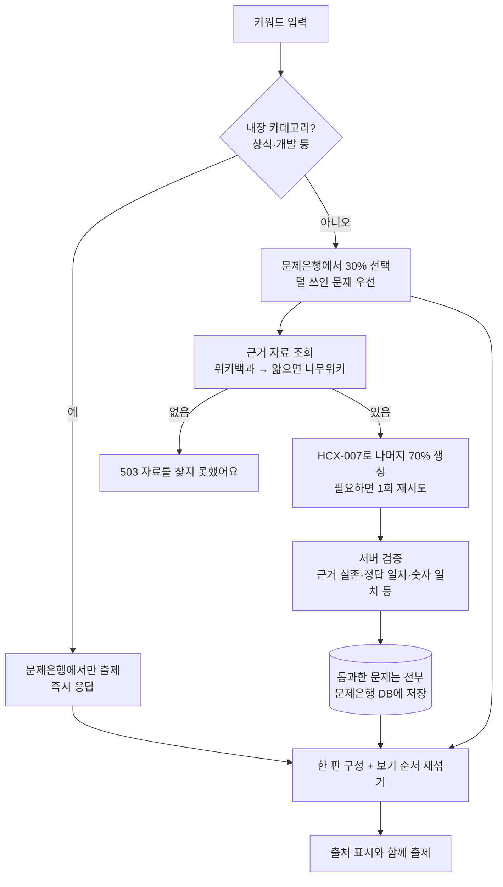
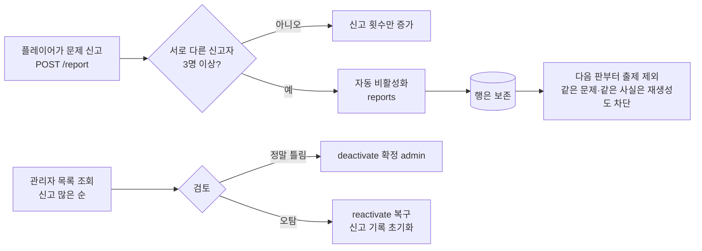

# AI 문제 생성 (CLOVA Studio + 위키 근거 + 문제은행)

사용자가 키워드("손흥민", "흑백요리사" 등)를 입력하면 **위키 문서를 근거로** HyperCLOVA X가 4지선다 퀴즈를 만들고, 검증을 통과한 문제만 쓰고 **DB 문제은행에 쌓습니다.**

> **지연 처리**: 아래 흐름 중 "근거 자료 조회 ~ 서버 검증"(15~30초)은 방 생성 요청을 막지 않고 대기실에서 백그라운드로 실행됩니다. 내장 카테고리는 이 단계를 건너뛰어 즉시 준비됩니다.

## 한눈에 보는 흐름

## 왜 이렇게 만들었나 — 실험으로 확인한 사실

처음에는 키워드만 주고 모델의 기억으로 출제했는데 틀린 문제가 많았습니다. 원인을 실험으로 분리했습니다.

| 가설 | 실험 | 결과 |
|---|---|---|
| 모델이 약하다 | HCX-005 vs HCX-007 비교 | 005는 JSON이 깨지고 사실도 틀림. 007이 훨씬 나음. 그래도 오류 남음 |
| 모델의 지식이 오래됐다 | "손흥민의 **현재** 소속팀" | 토트넘이라고 답함. 위키에는 이미 LAFC |
| **자기검증**으로 잡을 수 있다 | 같은 모델에게 정답을 다시 풀게 함 | **못 잡음.** 같은 오래된 지식으로 답해서 "일치"로 통과 |
| 근거 자료를 주면 나아진다 | 위키백과 본문을 주고 출제 | 크게 개선 (리그 오브 레전드 전부 정상, 현재 소속팀 LAFC로 정확) |
| 모델이 정답 **번호**를 틀린다 | `answer: 인덱스` 방식의 출력 분석 | 근거와 모순되는 번호를 자주 붙임 (이적료 근거 2,000만인데 3,000만으로 표시 등) |

결론: **모델의 기억을 믿지 않고, 근거를 주고, 서버가 기계적으로 확인한다.**

## 근거 자료 (SourceService)

| 순서 | 출처 | 조건 |
|---|---|---|
| 1 | 한국어 위키백과 공식 API | 본문이 **2,500자 이상**이면 이것만 사용. **제목으로 직접 조회해 리다이렉트를 따라가고**(예: "뉴진스" → "NewJeans" 문서), 없으면 검색 1위를 쓰되 제목이 키워드와 겹칠 때만 인정 |
| 2 | 나무위키 `/w/{제목}` | 위키백과가 없거나 얇을 때 보강 (예: 카리나 277자 → 나무위키 6,000자) |
| 3 | 없음 | 생성하지 않고 `503` ("참고할 자료를 찾지 못했어요") |

- 본문은 6,000자까지만 사용하고, 위키백과의 각주·외부 링크·같이 보기 구간은 제거합니다.
- 검색 결과가 키워드와 무관하면 버립니다. (무의미한 키워드에 "이름공간" 문서가 돌아온 실제 사례가 있었음) 단 제목 직접 조회는 사람이 만든 리다이렉트라 이 검사를 하지 않습니다 — 처음에는 검색 결과에만 의존해서 문서 제목이 영어인 "뉴진스"(→ NewJeans)가 "자료 없음"으로 실패하는 버그가 있었고, 비동기 준비를 실측하다가 발견해 고쳤습니다.
- 동음이의 문서는 버립니다.
- **캐시**: 성공 6시간 / 없음 10분 / 오류 1분. 위키백과는 12번쯤 연속 호출하면 429가 오고, 나무위키는 문서 하나가 1~2MB입니다.
- 위키백과는 User-Agent가 없으면 403입니다. `quizrun.sources.user-agent`로 식별 가능한 값을 보냅니다.

### 라이선스
- 위키백과: CC BY-SA, 나무위키: **CC BY-NC-SA 2.0 KR (비영리)**. 상용 서비스로 확장하면 나무위키는 쓸 수 없습니다. `quizrun.sources.namu-enabled=false`로 끌 수 있습니다.
- 사용한 문서는 방 상태의 `credits`(예: `"위키백과 · 손흥민"`)로 내려가며, 화면에 출처를 표시해야 합니다(프론트 작업).

## 생성 (ClovaQuestionGenerator)

- 모델 `HCX-007`(추론 모델), `maxCompletionTokens` + `thinking.effort=low`. 모델은 설정으로 바꿀 수 있습니다.
- 출력 형식은 번호가 아니라 **정답 텍스트와 오답 3개**입니다: `{text, correct, wrong[3], evidence}`.
  서버가 `[정답, 오답1, 오답2, 오답3]`으로 보기를 조립하고 순서를 섞으므로 "정답 번호를 틀리게 매기는" 오류가 구조적으로 없습니다.
- `evidence`는 **자료에서 한 글자도 바꾸지 않고 복사한 문장**이어야 합니다.
- 필요한 문제 수의 약 1.5배를 요청하고, 검증 통과분이 모자라면 **한 번 더** 요청합니다(이미 만든 문제는 제외하도록 프롬프트에 전달).
- 동시 호출 상한(기본 4)을 넘으면 호출하지 않습니다 — 쿼터·비용 보호.

## 서버 검증 규칙 — 하나라도 어긋나면 그 문제를 버린다

| # | 규칙 | 막는 오류 (실제로 관찰한 사례) |
|---|---|---|
| 1 | 정답 1개 + 오답 3개, 모두 비어 있지 않고 서로 다름 | 형식 오류 |
| 2 | **근거 문장이 자료에 실제로 존재** (공백·기호 차이는 무시) | 지어낸 근거 — 뉴진스 "Ditto가 핫100 첫 진입곡" |
| 3 | **정답이 근거 문장 안에 있음** | 근거와 모순되는 정답 — 근거 "2,000만 파운드"인데 정답 "3,000만 파운드" |
| 4 | **문제 본문의 숫자(2자리 이상)가 근거에도 있음** | 연도 오기 — 근거는 "2015년 준우승"인데 문제는 "2023년 아시안컵" |
| 5 | 부정형 금지 ("~이 아닌 것", "옳지 않은 것" 등) | 정답이 "틀린 사실"이라 근거 검증이 무의미해짐 |
| 6 | "정보 없음" 같은 보기 금지 | 정답 위치를 알려 주는 힌트 |
| 7 | 문제 본문에 "자료", "본문" 언급 금지 | 자료 없이 읽으면 뜻이 통하지 않음 |
| 8 | 본문이 같은 문제 중복 제거 | 중복 |

LLM을 한 번 더 호출하는 "판정 모델" 방식은 쓰지 않습니다. 같은 모델이 같은 오해를 반복하고, 비용·지연이 늘기 때문입니다. 위 규칙은 전부 문자열 비교라 비용이 0이고 결과가 결정적입니다.

## 문제은행 (QuestionVault)

검증을 통과한 문제는 **이번 판에 쓰지 않는 여분까지 전부** DB에 저장됩니다.

| 항목 | 내용 |
|---|---|
| 테이블 | `stored_question` — 키워드(topic), 본문, 보기 4개, 정답, 근거 문장, 출처(사이트·제목), 출제 횟수, 생성 시각 |
| 중복 방지 | 같은 키워드에서 **본문 해시** 중복, 그리고 **같은 근거 문장에서 나온 문제**(같은 사실을 다르게 물은 문제)는 저장·출제하지 않음 (예: "생년월일은?"/"생년월일은 언제인가?") |
| 선택 | 덜 쓰인 문제 우선, 동률은 무작위. 출제할 때마다 **보기 순서를 새로 섞음** |
| 초기 데이터 | 처음 기동 시 내장 문제 180개(15개 카테고리)를 `origin=seed`로 적재 |
| DB | 기본 파일 H2. `DB_URL`로 NCP **Cloud DB for MySQL**로 전환 (**MySQL 8.0.46 컨테이너에서 실행 검증**, 실제 Cloud DB 인스턴스는 아님). 스키마 설계: [DB 설계서](database-design.md) |

### 품질 관리 루프: 신고 → 자동 제외 → 관리자 검토

- 기준 횟수는 `REPORT_THRESHOLD`(기본 3). 같은 참가자는 한 문제를 한 번만 신고할 수 있습니다.
- 비활성 문제도 행을 남기기 때문에, 같은 본문뿐 아니라 **같은 근거 문장**에서 AI가 다시 만든 문제도 저장되지 않습니다.
- 진행 중인 판은 건드리지 않고 다음 판부터 빠집니다.
- 내장 카테고리의 문제도 신고로 제외되며, 제외된 후에는 그 카테고리가 문제 수를 줄여서(절반 이상 남아 있을 때) 진행합니다. 내장 폴백 경로에서도 제외된 문제는 빠집니다.
- 내장 폴백으로 나간 문제(문제은행 행과 연결되지 않음)는 신고해도 기록되지 않습니다(`recorded: false`).

### 한 판 구성 비율
- 기본: 문제은행 **30%** + 새로 생성 **70%** (`quizrun.quiz.bank-ratio: 0.3`).
- 문제은행이 커지면 값을 올려(예: 0.7) AI 호출·지연·비용을 줄입니다.
- 생성이 모자라면 문제은행에서 더 채웁니다. 그래서 같은 키워드를 반복할수록 "문제은행 비율"이 자연스럽게 올라갑니다.
- AI 문제를 **절반 이상(최소 3개)** 확보했다면 문제 수를 줄여서 진행합니다. 관련 없는 내장 문제로 대체하지 않습니다. (실제 사례: "흑백요리사"가 별칭 "요리"에 걸려 팝콘·초콜릿 문제가 나간 적이 있어 수정)
- 그보다 적으면: 별칭으로 연결되는 내장 카테고리가 있으면 그것으로(예: "축구" → 스포츠), 없으면 `503`.
- 내장 카테고리 이름(상식·개발·과학…) 자체를 입력하면 AI를 부르지 않고 문제은행만 씁니다. 범위가 너무 넓어 근거 문서가 의미 없고, 응답이 즉시 나옵니다.

## 실측 (2026-10-23, 위키백과 + HCX-007)

| 키워드 | 자료 | 소요 | 결과 |
|---|---|---|---|
| 손흥민 | 위키백과 | 약 16~26초 | 6문제 전부 위키 내용과 일치 (골든 부트 2021-22, 도움 101개, 청룡장, 현재 LAFC 등) |
| 카리나 | 위키백과 277자 → 나무위키 6,000자 | 약 15초 | 6문제 생성 |
| 흑백요리사 | 위키백과 | 약 19~30초 | 관련 문제 6개 (문제은행 2 + 신규 4) |
| 로제 아파트 | 없음 | 0.9초 | 503, 이유를 설명하는 메시지 |

## 알려진 한계 (솔직하게)

1. **자료가 틀리면 문제도 틀립니다.** 특히 나무위키는 사용자 편집 문서입니다. 검증은 "문제가 자료와 일치하는가"이지 "자료가 맞는가"가 아닙니다.
2. **검증을 통과한 오류가 남을 수 있습니다.** 규칙 2~4는 큰 오류 유형을 막지만, 근거 안에서 엉뚱한 부분을 질문하는 경우(예: "살라와 공동 수상" → 문제는 "파트너는?")까지는 막지 못합니다. 그래서 **신고 → 자동 제외 → 관리자 검토** 루프를 두었습니다(위). 다만 로그인이 없어서 **악의적으로 여러 참가자를 만들어 정상 문제를 신고하는 것은 막지 못합니다**(참가자 단위로 1회만 인정). 오탐은 관리자 복구로 되돌립니다. 사용자 인증과 IP별 제한이 필요합니다.
3. **저장된 문제에는 새 검증 규칙이 소급 적용되지 않습니다.** 규칙을 강화하면 기존 문제를 재검증하는 작업이 필요합니다. (개발 중에는 DB 볼륨을 초기화했습니다)
4. **준비 자체는 여전히 15~30초 걸립니다.** 다만 이제 방 생성 요청을 붙잡지 않고 **대기실에서 비동기로 진행**되며 `state.prepare`로 진행 상태가 내려갑니다([API 명세](api.md#방-생성과-문제-준비-비동기)). 문제은행 비율을 올리면 준비 시간이 줄어듭니다.
5. **정답이 모호한 문제**(예: 리드보컬/메인보컬처럼 비슷한 보기)는 자동으로 못 거릅니다.
6. 호출 비용과 사용자별 호출 제한은 아직 없습니다 (동시 호출 상한만 있음).
