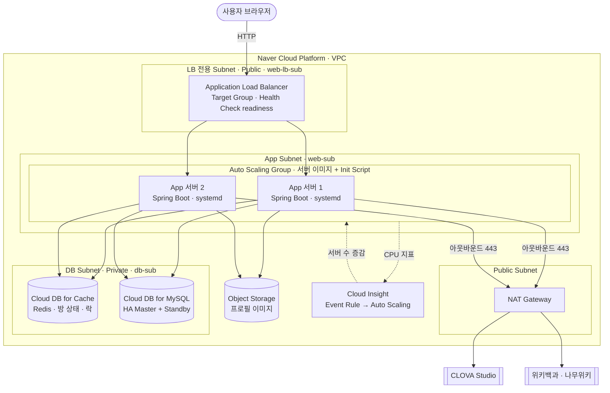
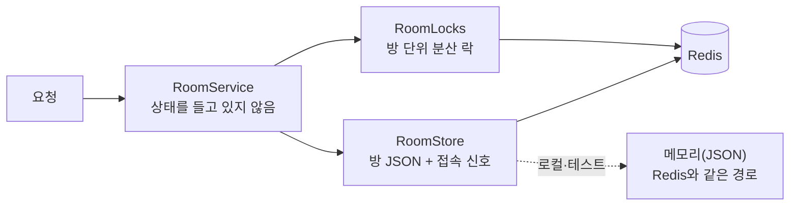

# 아키텍처

> 표기: ✅ 구현하고 실행으로 검증 / 🟡 일부만 / 📐 설계(NCP 리소스·코드 없음) / ❌ 되어 있지 않음
>
> **이 문서의 구성은 수업(Day1~5)에서 다룬 서비스만으로 만들었습니다.** 수업 기술을 얼마나 활용했는지는 [클라우드 활용 검증 보고서](cloud-alignment.md), VM에 올리는 방법은 [VM 배포 가이드](deploy-vm.md), DB는 [DB 설계서](database-design.md)에 있습니다.
>
> **현재 상태 요약**: 백엔드는 **서버를 여러 대로 늘릴 수 있도록** 만들어졌고(방 상태를 Cloud DB for Cache(Redis)에 둠), **로컬에서 서버 2대 + LB + Redis + MySQL로 검증**했습니다. **NCP 리소스(VPC·서버·LB·Auto Scaling·Cloud DB)는 아직 만들지 않았습니다** — 그건 인프라 담당(정하람)의 작업이고, 그때 백엔드를 올리는 방법을 `deploy-vm.md`에 정리했습니다.

## 1. 목표 구성 (수업 Day4 "2-Tier")

수업 Day4의 표준 구성: *Application Load Balancer → Web/App ASG → Cloud DB for MySQL*, 무상태를 성립시키는 보조 저장소로 *Cloud DB for Cache(Redis), Object Storage*. Spring Boot가 정적 파일과 API를 함께 서빙하므로 웹/앱 계층을 나누지 않는 2-Tier로 충분합니다.



**ACG 체인**(수업 Day1 최소 권한 · 실습 11): `인터넷 → LB(80/443)`, `LB → 앱 ACG(TCP 3000)`, `앱 ACG → DB ACG(TCP 3306, 접근 소스 = 앱 ACG)`, `앱 ACG → Cache ACG(Redis 포트, 접근 소스 = 앱 ACG)`. 앱 서버의 아웃바운드는 NAT Gateway를 거쳐 CLOVA·위키로만 나갑니다. 규칙표는 [VM 배포 가이드 1.1](deploy-vm.md#11-acg-day1-최소-권한-실습-11).

**서브넷**(실습과 같은 값): `web-sub 10.0.1.0/24`, `web-lb-sub 10.0.2.0/24`(LB), `db-sub 10.0.3.0/24`(Private).

### 1.1 로컬에서 같은 구조를 흉내 낸 검증 구성 ✅

NCP 리소스가 없어도 구조를 검증할 수 있도록 `docker-compose.scale.yml`이 위 구성을 로컬에서 재현합니다(검증용이며 NCP 리소스가 아닙니다).

```
브라우저 ─▶ lb(nginx, Round Robin) ─▶ app1 / app2 (같은 코드, SPRING_PROFILES_ACTIVE=redis) ─▶ redis · mysql
```

## 2. 핵심 설계 결정

### 2.1 타이머 대신 "마감 시각 따라잡기" ✅

기존 Node 서버는 방마다 `setTimeout`을 걸어 단계를 넘겼습니다. 이 방식은 **타이머를 가진 프로세스가 곧 방의 주인**이라 서버를 2대로 늘리면 어느 서버가 단계를 넘길지 정할 수 없습니다.

그래서 타이머를 없앴습니다. 방은 `phase`와 `deadline`(현재 단계가 끝나는 시각)만 저장하고, **어떤 요청이든 방을 읽은 뒤 `advance()`가 마감이 지난 단계를 순서대로 따라잡습니다.**

```
요청 도착 → (락) → 방 읽기 → advance(now) → 요청 처리 → 방 쓰기 → (락 해제)
```

- 10분 동안 아무도 요청하지 않다가 조회해도 `finished`까지 한 번에 따라잡습니다 (`longIdleGapCatchesUpThroughAllPhases` 테스트).
- 시각은 `Clock` 빈으로 주입해서 테스트에서 sleep 없이 카운트다운·마감·속도 점수를 검증합니다.
- 마감 직후 두 서버가 동시에 폴링해도 채점은 **한 번만** 반영됩니다(`aTimedOutQuestionIsAdvancedByWhicheverServerSeesItFirstExactlyOnce`).

### 2.2 무상태 설계: 방 상태를 Cloud DB for Cache(Redis)로 ✅

수업 Day4: *"서버가 사라져도 잃을 것이 없어야 한다. 서버는 계산만 한다. 어느 서버가 요청을 받아도 결과가 같다."*

**예전**에는 방을 서버 메모리에 두어서 서버 2대 실험에서 "A에서 만든 방을 B가 모른다(404)"가 났습니다. **지금은** 방을 Redis에 JSON으로 저장하고, 실험을 다시 해서 통과했습니다([검증 보고서 3.1](cloud-alignment.md#31-서버-2대-실험--무상태-설계-day4)).



| 요소 | 구현 | 이유 |
|---|---|---|
| 방 저장 | `quizrun:room:{code}` = 방 전체 JSON, **TTL = 방 만료 시간** | 서버가 없어도 만료된 방이 저절로 사라진다. `find`는 항상 **복사본**을 돌려준다 |
| 변경의 직렬화 | **방 단위 분산 락** `SET NX PX 10초` + 내 토큰일 때만 해제(Lua) | 서버 둘이 같은 방을 동시에 고쳐도 유실이 없다. 서버가 락을 잡은 채 죽어도 10초 뒤 풀린다. 대기 한도 5초 후 503 |
| **폴링은 락 없이** | `state`는 마감이 안 지났으면 방을 읽기만 하고, 접속 신호(`quizrun:presence:{code}`)만 별도 키에 기록 | 100명이 700ms마다 부르는 요청이 락에서 줄 서지 않게. 폴링이 방을 다시 쓰지 않는다는 것을 테스트로 증명 |
| 방 코드 중복 방지 | `SET NX`(`saveIfAbsent`) | 서버가 여럿이어도 같은 코드가 발급되지 않는다 |
| 만료·삭제된 방 | 저장은 `SET XX`(이미 있을 때만) | 늦게 도착한 요청이 삭제된 방을 되살리지 않는다 |
| 롤링 배포 | 방 JSON을 읽을 때 **모르는 필드는 무시** | 서버를 하나씩 교체할 때 신구 버전이 섞여도 깨지지 않는다 |
| 서버 장애 | 준비 중이던 방은 **180초 후** 아무 서버든 발견하면 실패 처리 | 준비를 맡은 서버가 죽어도 방이 영원히 `preparing`에 남지 않는다 |
| 로컬·테스트 | 메모리 저장소도 **같은 JSON 방식** | 직렬화 오류나 저장 누락이 테스트에서 숨지 않는다 |

**켜는 법**: `SPRING_PROFILES_ACTIVE=redis` + `REDIS_HOST` 등. 켜지 않으면 서버 1대용 메모리 모드입니다(로컬 개발·테스트). 이 프로파일은 Redis에 연결되지 않은 서버의 `readiness`를 503으로 만듭니다(2.7).

**검증**: 자동 테스트 135개(서버 2대를 흉내 낸 동시성 테스트 포함, 진짜 Redis 통합 테스트 11개), 서버 2대 + LB + Redis + MySQL 실험, 게임 도중 서버 1대 강제 종료, Redis 정지·복구([검증 보고서](cloud-alignment.md)).

**알려진 한계**
- **Redis 한 대가 새 단일 장애점**입니다. Redis가 멈추면 방 조회·생성이 500이 되고(서버는 `readiness 503`으로 LB에서 제외됨), 복구되면 5~10초 안에 스스로 정상화합니다. Cloud DB for Cache의 가용성 옵션은 인프라 담당과 확인해야 합니다. Redis가 **데이터를 잃으면 진행 중인 방이 사라집니다**(방은 영속 DB에 없다 — 3장).
- 락은 `lease 10초`가 지나면 풀리므로, 락 구간이 그보다 오래 멈추면(긴 GC 등) 두 서버가 동시에 들어갈 수 있습니다. 이 서비스의 락 구간은 수 ms(Redis 왕복 몇 번 + DB 한두 번)라 위험이 낮습니다.
- 방 목록(`GET /api/rooms`)은 방 코드 색인을 읽어 방 전체를 가져옵니다. 방이 수천 개가 되면 대기 중인 방만 담은 별도 색인이 필요합니다.
- 준비 작업(AI 문제 생성)은 방을 만든 서버의 스레드에서 돌고, 그 서버가 죽으면 준비 중이던 방은 위의 타임아웃 후 실패 처리됩니다(사용자는 새 방을 만들어야 함).

### 2.3 AI는 신뢰하지 않는다 ✅

모델의 기억이 아니라 **위키 근거 자료**로 출제하게 하고, 서버가 근거 문장 실존·정답 일치·숫자 일치를 기계적으로 검증합니다. 탈락한 문제는 버리고, 통과한 문제는 DB 문제은행에 쌓습니다. 상세와 실험 결과는 [AI 문제 생성](ai-question-generation.md).

### 2.4 문제은행 DB: 쓸수록 커지는 자산 ✅

검증을 통과한 문제는 이번 판에 쓰지 않는 여분까지 DB에 저장합니다. 한 판은 문제은행 30% + 신규 생성 70%로 구성하고(설정), 같은 사실을 묻는 중복은 근거 문장 기준으로 막습니다. 문제은행이 커질수록 비율을 올려 **AI 호출 비용과 응답 시간을 줄일 수 있습니다.**
로컬은 H2 파일, NCP에서는 `DB_URL`만 바꿔 Cloud DB for MySQL을 씁니다. **MySQL 8.0.46 컨테이너에서 실행 검증했습니다**(실제 Cloud DB 인스턴스는 아님). 문제은행은 **서버 여러 대가 같은 MySQL을 공유**합니다(서버 2대로 확인). 목표 스키마와 이행은 [DB 설계서](database-design.md).

### 2.5 신고 → 자동 제외 → 관리자 검토 ✅

AI 출제는 검증을 거쳐도 완벽하지 않으므로 사람의 신고를 마지막 방어선으로 둡니다. 서로 다른 신고자 3명이 쌓이면 문제를 **삭제하지 않고 비활성화**합니다. 행을 남겨야 AI가 같은 문제·같은 근거 문장으로 다시 만들어 되살리는 것을 막을 수 있습니다. 관리자 API(`X-Admin-Token`)로 신고 많은 순 목록을 보고 확정하거나 오탐을 복구합니다. 관리자 API는 `ADMIN_TOKEN`을 설정하지 않으면 꺼집니다. 상세는 [AI 문제 생성](ai-question-generation.md#품질-관리-루프-신고--자동-제외--관리자-검토).

### 2.6 대기실에서 비동기로 문제 준비 ✅

문제 준비(위키 조회 + LLM, 15~30초)를 방 생성 요청 안에서 기다리면 사용자가 빈 화면을 봅니다. 그래서 **방을 먼저 만들고 문제는 백그라운드 스레드풀에서 준비**합니다.

- 방 생성은 수십 ms 안에 `201`로 응답하고, 방은 `prepare=preparing`으로 시작합니다. 참가자는 그동안 입장·채팅을 할 수 있습니다(대기실이 곧 로딩 화면).
- 상태는 기존 폴링 `state`에 `prepare`·`prepareError`를 얹어 전달합니다. 새 엔드포인트도 새 연결 방식도 필요 없습니다.
- 준비 중 시작 요청은 기억해 두었다가 준비가 끝나면 카운트다운을 시작합니다.
- 오래 걸리는 `compose`는 **방 잠금 밖에서** 돌리고 결과를 반영할 때만 잠급니다. 그래서 준비 중에도 다른 요청(입장·채팅·조회)이 막히지 않습니다.
- 스레드풀(4)이 곧 동시 생성 상한이고 대기열(50)이 넘치면 새 방은 "요청이 많아요"로 실패 처리합니다 — CLOVA 쿼터와 서버를 보호합니다.
- 내장 카테고리·AI 꺼짐은 DB만 쓰므로 예전처럼 요청 안에서 즉시 처리해, 입력 오류도 즉시 4xx로 돌려줍니다.
- 실패한 방은 목록에서 빼고 10분 뒤 정리합니다. 준비가 180초를 넘기면 어느 서버든 실패 처리합니다(2.2).

### 2.7 LB 헬스체크: `liveness`와 `readiness`를 구분 ✅

수업 Day4: Target Group의 Health Check가 죽은 서버를 분산 대상에서 제외합니다. 실습은 **HEAD**, 경로 `/`, 주기 30초, 실패 임계값 2였습니다.

| 경로 | 의미 | Redis 정지 시 | 용도 |
|---|---|---|---|
| `/api/health` | 프로세스가 응답한다 | **200 (감지 못 함)** | 단순 생존 확인 |
| `/actuator/health/liveness` | 프로세스가 살아 있다 | 200 | 재시작 판단 |
| **`/actuator/health/readiness`** | **요청을 받을 준비가 되었다** | **503** | **LB Target Group 헬스체크(권장)** |

HEAD·GET 모두 200/503을 정확히 돌려주는 것을 확인했습니다. Redis가 돌아오면 서버가 스스로 200으로 복귀합니다(재시작 불필요).
⚠️ 실습의 주기(30초) × 임계값(2)이면 죽은 서버가 **최대 약 60초** 분산 대상에 남습니다. **주기를 5~10초**로 줄일 것을 권장합니다([배포 가이드 4장](deploy-vm.md#4-헬스체크-target-group)).

### 2.8 배포: 서버 이미지 + Init Script (Docker 없이) 🟡

수업의 배포 흐름은 **서버 이미지 → Launch Configuration(+Init Script) → Auto Scaling Group**입니다. 이 백엔드는 jar 하나이므로 Docker 없이 같은 흐름에 올라갑니다.

| 단계 | 산출물 | 상태 |
|---|---|---|
| 앱 설치(골든 서버, 1회) | `deploy/vm/install-app.sh` — Java 21, 서비스 계정, jar, systemd 등록. **설정 파일은 비운다(이미지에 비밀값 없음)** | ✅ Rocky Linux 8.9에서 실행 |
| 서비스 | `deploy/vm/quizrun.service` — 설정이 비어 있으면 시작 안 함, 크래시 시 자동 재시작, 정상 종료(143)는 성공 처리 | ✅ `kill -9` 후 약 19초에 복구 |
| 서버 생성 시 설정 | `deploy/vm/init-script.sh` — **영어만·주석 없음·shebang**(수업 Day2 규칙, 자동 테스트로 고정) + `render-init-script.py`로 값 채우기 | ✅ 약 16초 만에 readiness 200 |
| NCP 콘솔(이미지·Launch Configuration·ASG·LB) | 인프라 담당. 값 제안은 [배포 가이드](deploy-vm.md) | 📐 |

Docker는 **개발·검증 편의 수단**으로만 씁니다(수업 범위 밖). 배포되는 실체는 jar이고 Docker 이미지가 아닙니다.

### 2.9 프론트 계약 유지 ✅

JSON 키 구조를 기존 서버와 비교해 동일함을 확인했습니다. 프론트는 한 줄도 바꾸지 않아도 동작합니다. 서버를 늘려도 프론트 변경은 없습니다.

## 3. 수업 기술 매핑

상세 근거는 [검증 보고서 2장](cloud-alignment.md#2-수업-기술별-검증-day15)입니다.

| 수업 | 서비스 | 이 프로젝트에서의 역할 | 상태 |
|---|---|---|---|
| Day1 | VPC · Subnet (Public/Private) · CIDR | LB / 앱 / DB를 서브넷으로 분리 | 📐 |
| Day1 | **NAT Gateway** | Private 앱 서버가 CLOVA·위키를 호출하는 유일한 출구 | 📐 |
| Day1 | ACG · Network ACL | LB→앱 3000, 앱→DB 3306, 앱→Cache만 허용 | 📐 규칙표 작성 |
| Day2 | Server · **서버 이미지 · Init Script** | 앱 서버를 똑같이 복제(Launch Configuration의 재료) | 🟡 스크립트 작성·Rocky 8.9 검증, NCP 미실행 |
| Day3 | **Object Storage** | 프로필 이미지(기획서) | ❌ |
| Day3 | Block · NAS | 사용하지 않음 | ➖ |
| Day4 | **Application Load Balancer** · Target Group · Health Check | 요청 분산, 서버 장애 감지 | 🟡 헬스체크(readiness)·Round Robin 분산을 **로컬 nginx로 검증**, NCP LB 미생성 |
| Day4 | **Auto Scaling** (Launch Configuration · ASG · 정책) | 퀴즈 시작 시각의 접속 폭주 대응 | 📐 **전제(무상태·배포 수단)는 충족**, 콘솔 구성은 인프라 담당 |
| Day4 | **무상태 설계 · Cloud DB for Cache (Redis)** | 방 상태·락·접속 신호 | ✅ 구현·컨테이너로 검증 (실제 Cloud DB for Cache 미검증) |
| Day4 | **Cloud Insight** · Event Rule | CPU 기준 서버 증감 | 📐 |
| Day5 | **Cloud DB for MySQL** (HA, db-sub, DB ACG) | 문제은행·신고·(예정) 기록 | ✅ 코드·스키마 / ❌ 인스턴스 |

**수업 범위 밖이지만 서비스에 필요한 외부 요소**: CLOVA Studio(LLM, 팀 과제의 핵심), 위키백과 API·나무위키(근거 자료), Docker(개발·검증 편의 수단), nginx(로컬 LB 흉내).

### 3.1 데이터 배치

| 데이터 | 저장소 | 상태 |
|---|---|---|
| 문제, 보기, 근거 문서, 신고, 사용자, 끝난 방·참가·응답 | **Cloud DB for MySQL** | 문제·신고 ✅ / 사용자·기록 ❌([DB 설계서](database-design.md)) |
| 진행 중 방 상태, 접속 여부, 락 | **Cloud DB for Cache(Redis)** | ✅ |
| 채팅(최근 100개) | 방 JSON에 포함 → Redis | ✅ (영속 보관 안 함) |
| 프로필 이미지 | **Object Storage** (키만 MySQL) | ❌ |

## 4. 단계별 로드맵

| 단계 | 내용 | 상태 |
|---|---|---|
| 1 | Spring Boot 이식 · 프론트 계약 동일 · 마감 시각 기반 엔진 | ✅ |
| 1.5 | 위키 근거 기반 AI 출제 · 서버 검증 · JPA 문제은행 · 30/70 혼합 출제 | ✅ |
| 1.6 | 문제 신고 · 기준 횟수 자동 제외 · 관리자 비활성화/복구 | ✅ |
| 1.7 | 대기실에서 비동기 문제 준비 · `state.prepare` | ✅ |
| 1.8 | MySQL 8 연결 검증 · 목표 스키마 DDL·제약 시험 · v1→v2 이행 스크립트 | ✅ (컨테이너) |
| **2** | **방 상태 → Cloud DB for Cache(Redis) 외부화**, 서버 2대 실험·장애 전환·Redis 정지 검증 | ✅ (컨테이너) |
| **3** | **서버 이미지 + Init Script + systemd 배포 절차** (`deploy/vm/`), Rocky Linux 8.9 검증 | ✅ (NCP 미실행) |
| 4 | **NCP 리소스 구성**: VPC/Subnet/ACG/NAT, 골든 서버 → 서버 이미지, Application LB + Target Group, Launch Configuration + ASG, Cloud DB for MySQL(HA) + Cache | 📐 **인프라 담당** — [배포 가이드](deploy-vm.md) |
| 4.1 | 실제 Cloud DB for Cache·MySQL에 연결해 재검증(인증·SSL) | 📐 4 이후 |
| 5 | DB v2 이행(코드 전환), 로그인·전적·마이페이지 | 📐 |
| 6 | Object Storage 프로필 이미지 | 📐 |
| 7 | 부하 테스트 → Cloud Insight Event Rule 임계값, Health Check 주기 | 📐 |
| 8 | 기획서 규칙 보완(최소 인원·이탈·방장 승계·동점), rate limit·인증, WebSocket | 📐 |

## 5. 알려진 위험

| 위험 | 영향 | 대응 |
|---|---|---|
| **Redis가 새 단일 장애점** | Redis 정지 시 방 조회·생성 500, 서버는 readiness 503으로 LB에서 제외. **Redis가 데이터를 잃으면 진행 중인 방 소실** | Cloud DB for Cache 가용성 옵션 확인(인프라). 복구 후 5~10초 내 자동 정상화는 검증함 |
| Health Check 주기가 길면 죽은 서버로 요청이 감 | 최대 ≈ 주기 × 실패 임계값 동안 일부 요청 실패(프론트는 700ms마다 재시도) | 주기 5~10초 권장, 경로는 `readiness` |
| ASG 서버가 **처음에 동시에** 켜지며 테이블 자동 생성 충돌 가능(`ddl-auto=update`) | 첫 기동 실패 | 처음엔 서버 1대로 시작 후 확장. 근본 해결은 스키마를 SQL로 먼저 적용 + `validate`([배포 가이드 7장](deploy-vm.md#7-db-스키마-처음-적용)). **직접 재현은 하지 않음** |
| 실제 Cloud DB for Cache 연결 미검증(인증·SSL) | 접속 실패 가능 | 코드는 `REDIS_PASSWORD`·`REDIS_SSL` 지원. 인스턴스가 생기면 4.1에서 검증 |
| LLM 환각(틀린 정답) | 게임 신뢰도 | **근거 문장 실존·정답 일치·숫자 일치 검증 구현.** 자료 자체의 오류와 근거 안의 엉뚱한 질문은 못 막음 → 신고 기능으로 보완 |
| 문제은행에 저장된 오답 문제 | 계속 재출제됨 | **신고 3회 누적 시 자동 제외 + 관리자 확정/복구 구현.** 규칙 강화 시 기존 문제 재검증 배치는 미구현 |
| 신고 악용 (로그인 없음) | 정상 문제가 제외될 수 있음 | 참가자당 1회, 서로 다른 3명 기준. 관리자 복구로 되돌림. 근본 해결은 인증·IP 제한 |
| 나무위키 라이선스·차단 | 비영리 한정, 서버 IP 차단 가능 | 위키백과 우선, 얇을 때만 사용, 캐시. 상용 시 비활성화. NCP 서버 IP에서의 접근은 미검증 |
| 문제 준비에 15~30초 (대기실에서 진행) | 첫 사용감 | **비동기 준비 구현.** 프론트가 "준비 중" 표시를 해야 함. 문제은행 비율을 올리면 단축 |
| 프론트를 Object Storage에 올리면 API 호출 실패 | 호스팅 방식 제약 | 현재 프론트는 상대 경로만 쓰고 백엔드는 CORS 403. 앱 서버가 프론트도 서빙하는 구성을 권장 |
| 키워드 남용으로 API 비용·쿼터 소진 | 비용 | 동시 호출 상한(구현), IP별 제한(예정) |
| DB 스키마가 `ddl-auto=update`로 자동 변경됨 | 운영 DB 변경 위험 | 운영 전 SQL 직접 적용 + `validate` ([DB 설계서 6.2절](database-design.md#62-차이와-영향)) |
| 폴링 700ms × 100명 | 요청량 | 폴링은 **방을 다시 쓰지 않는다**(테스트로 증명). 간이 측정: 100명 폴링에서 오류 0건. Redis 모드의 부하는 **측정하지 않았다** — 부하 테스트 필요 |
