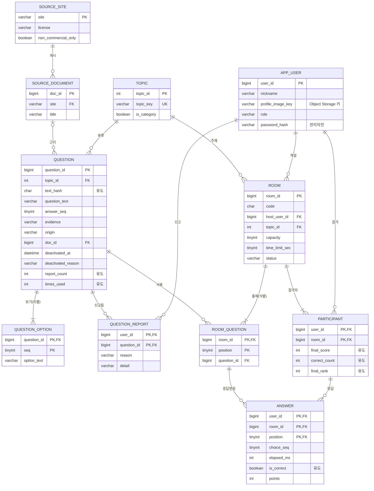

# 데이터베이스 설계서

QUIZRUN의 DB를 **수업(데이터베이스 시스템 5장)의 설계 순서**대로 설계한 결과입니다.
요구사항 분석 → **개념적 설계(ER)** → DBMS 선정 → **논리적 설계(관계 스키마)** → 정규화 → 물리적 설계 → 보안 설계.

> **읽기 전에 — 이 문서의 상태**
> - 이 문서의 목표 스키마 [`db/schema.sql`](../db/schema.sql)은 **MySQL 8.0.46에서 실제로 실행하고 제약조건을 시험했습니다**(9장).
> - 그러나 **현재 Spring 코드는 아직 이 스키마를 쓰지 않습니다.** 코드는 단순한 v1 스키마(테이블 2개)로 동작하고, 이 문서의 목표 스키마(v2, 테이블 11개)로 옮기는 방법은 6장과 [`db/migrate-from-v1.sql`](../db/migrate-from-v1.sql)에 있습니다(이행 스크립트도 실행해 검증).
> - v1은 수업에서 배운 원칙과 어긋나는 부분이 있습니다(보기를 `option1~4` 열로 둔 것, 키워드·출처를 문자열로 반복 저장한 것, FK 없음 등). **숨기지 않고 6장에 차이를 정리했습니다.**

| 단계 (수업 표 5.1) | 절 | 산출물 |
|---|---|---|
| ① 요구사항 수집·분석 | 1 | 작은 세계 기술, 요구사항 R1~R14, 트랜잭션 T1~T7 |
| ② 개념적 설계 | 2 | 엔티티·관계·애트리뷰트·도메인·키, **ER 다이어그램** |
| ③ DBMS 선정 | 3 | MySQL 8(영속) + Cache(휘발) 분리 |
| ④ 논리적 설계 | 4 | 사상 알고리즘 7단계 적용, **관계 스키마 11개**, 무결성 제약 |
| ⑤ 정규화 | 5 | 함수적 종속성 분석, 의도적 비정규화 |
| (구현과의 대응) | 6 | v1 ↔ v2 차이, 이행 |
| ⑥ 물리적 설계 | 7 | 타입·인덱스·트랜잭션·SQL |
| ⑦ 보안 설계 | 8 | 접근 제어·계정·백업 |

---

## 1. 요구사항 수집과 분석

### 1.1 작은 세계(miniworld)

**키워드로 방을 열면 참가자가 모여 같은 문제를 동시에 풀고, 점수·순위·기록이 남는 실시간 퀴즈 레이스.**
문제는 위키 자료를 근거로 AI가 만들고, 검증을 통과한 문제는 문제은행에 쌓이며, 신고와 관리자 검토로 품질을 관리한다.

- **범위 안**: 사용자, 키워드, 근거 자료, 문제와 보기, 신고, 방, 방에 출제된 문제, 참가, 응답(채점 결과)
- **범위 밖**(영속 DB에 넣지 않음, 3장): 진행 중 방 상태(단계·마감 시각·접속 여부), 채팅 메시지, 캐릭터 위치 — 짧게 살았다 사라지는 값이라 Cache에 둔다.

### 1.2 요구사항

출처: 팀 기획서(`프로젝트_기획 초안_5팀.pdf`), 현재 구현된 API. 기획서가 DB 설계 담당에게 요구한 범위는 **"방 · 문제 · 기록 DB 설계"** 입니다.

| ID | 요구사항 | 출처 | 필요한 데이터 |
|---|---|---|---|
| R1 | 사용자는 닉네임과 프로필 사진으로 로그인한다. 관리자도 로그인한다 | 기획서 5 | 사용자, 역할, 프로필 이미지 위치 |
| R2 | 방장이 키워드·정원·문제 수·제한시간으로 방을 연다 | 기획서 4 | 방, 키워드 |
| R3 | 열려 있는 방을 키워드로 검색해 입장한다. 시작 후 입장 불가 | 기획서 4, 6 | 방 상태, 키워드 |
| R4 | 문제는 키워드 주제로 제공된다. 문제마다 보기 4개와 정답이 있다 | 기획서 4 | 문제, 보기, 정답 |
| R5 | AI가 위키를 근거로 문제를 만들고, 정답 근거·출처를 남긴다 | 구현 | 근거 문장, 근거 문서, 출처 사이트 |
| R6 | 검증된 문제는 문제은행에 쌓이고, 같은 문제는 중복 저장하지 않는다 | 구현 | 문제 해시, 출제 횟수 |
| R7 | 한 방에 여러 문제가 순서대로 출제된다. 한 방에서 같은 문제는 한 번만 | 기획서 4 | 방-문제 출제 순서 |
| R8 | 문제마다 제한시간 안에 **한 번만** 제출한다. 시간 초과는 오답 | 기획서 6 | 응답, 응답 시간 |
| R9 | 정답은 1,000점 + 남은 시간 비율 최대 500점. 빠를수록 더 달린다 | 기획서 6, 구현 | 점수 |
| R10 | 최종 순위. 동점이면 정답 수, 평균 응답 속도 순 | 기획서 6 | 정답 수, 평균 응답 시간, 순위 |
| R11 | 참가자의 참여 기록·정답률(마이페이지), 틀린 문제 확인(결과 화면) | 기획서 4, 7 | 참가 기록, 응답 이력 |
| R12 | 도중에 나가면 이후 문제는 오답, 순위에는 남긴다 | 기획서 6 | 이탈 시각 |
| R13 | 사용자가 틀린 문제를 신고한다. 한 사람이 한 문제를 한 번만. 서로 다른 3명이면 자동 제외 | 구현 | 신고, 사유 |
| R14 | 관리자가 신고 문제를 검토해 제외·복구한다. 제외된 문제와 같은 사실은 재생성하지 않는다 | 기획서 5, 구현 | 비활성 시각·사유 |

### 1.3 트랜잭션·질의 목록

수업: *"스키마는 트랜잭션이 요구하는 모든 정보를 포함해야 한다."* 설계가 이 목록을 모두 처리할 수 있는지 4.4절과 7장에서 확인합니다.

| ID | 트랜잭션/질의 | 빈도 | 데이터 |
|---|---|---|---|
| T1 | 방 생성 + 출제 문제 확정 | 방당 1회 | room, room_question, participant(방장) |
| T2 | 출제 후보 조회(키워드의 활성 문제, 덜 쓰인 순) | 방당 1회 | question |
| T3 | 새로 만든 문제 저장(문제 + 보기 4개) | 방당 수 건 | question, question_option |
| T4 | **신고 접수 + 기준 도달 시 자동 제외** | 드묾 | question_report, question |
| T5 | **게임 종료 기록 확정**(참가·응답·순위) | 방당 1회 | participant, answer, room |
| T6 | 마이페이지: 내 참여 기록·정답률 | 자주 | participant, answer |
| T7 | 결과 화면: 내가 틀린 문제와 정답 | 자주 | answer, room_question, question, question_option |

---

## 2. 개념적 설계 (ER 모델, DBMS 독립)

수업의 ER 설계 순서(엔티티 식별 → 관계 식별 → 카디널리티 → 애트리뷰트·도메인 → 키 → 다이어그램 → 검사)를 따랐습니다.

### 2.1 엔티티 타입

| 엔티티 타입 | 구분 | 설명 | 식별자 |
|---|---|---|---|
| APP_USER | 강한 | 서비스 사용자(플레이어·관리자) | user_id |
| SOURCE_SITE | 강한 | 근거 자료를 가져오는 사이트(위키백과, 나무위키). 라이선스를 가짐 | site |
| SOURCE_DOCUMENT | 강한 | 근거 자료로 쓴 위키 문서 | doc_id (후보 키: site+title) |
| TOPIC | 강한 | 키워드. 내장 카테고리 또는 사용자가 입력한 키워드 | topic_id (후보 키: topic_key) |
| QUESTION | 강한 | 문제은행의 문제 | question_id (후보 키: topic+text_hash) |
| ROOM | 강한 | 한 판의 퀴즈 방 | room_id |
| **QUESTION_OPTION** | **약한** | 문제의 보기 | 부분 키 seq + 소유 엔티티 QUESTION의 키 |
| **ROOM_QUESTION** | **약한** | 방에 출제된 문제 | 부분 키 position + 소유 엔티티 ROOM의 키 |

- **방 식별자 결정**: 방의 6자리 코드는 시간이 지나면 재사용될 수 있어 키가 될 수 없다. 영속 기록이 필요하므로 대리 식별자 `room_id`를 쓰고 `code`는 조회용 애트리뷰트로 둔다.
- **약한 엔티티 선택 이유**: 보기는 문제 없이 존재할 수 없고 "3번 보기"는 문제와 함께일 때만 식별된다. 방 문제도 "방의 2번째 문제"로만 식별된다. 둘 다 소유 엔티티에 **전체 참여**한다.

### 2.2 관계 타입

(min,max)는 수업 표기입니다. 예: `QUESTION (1,1)`은 "문제는 이 관계에 최소 1번, 최대 1번 참여".

| 관계 | 참여 엔티티 | 차수·비율 | (min,max) | 관계 애트리뷰트 |
|---|---|---|---|---|
| CLASSIFIES(분류) | TOPIC — QUESTION | 2진 1:N | TOPIC (0,\*), QUESTION (1,1) | — |
| PUBLISHES(게시) | SOURCE_SITE — SOURCE_DOCUMENT | 2진 1:N | SITE (0,\*), DOC (1,1) | — |
| GROUNDS_ON(근거) | SOURCE_DOCUMENT — QUESTION | 2진 1:N | DOC (0,\*), QUESTION (0,1) | — (내장 문제는 근거 문서 없음) |
| HAS_OPTION(보기, 식별 관계) | QUESTION — QUESTION_OPTION | 2진 1:N | QUESTION (4,4), OPTION (1,1) | — |
| **REPORTS(신고)** | APP_USER — QUESTION | 2진 **M:N** | USER (0,\*), QUESTION (0,\*) | reason, detail, created_at |
| HOSTS(개설) | APP_USER — ROOM | 2진 1:N | USER (0,\*), ROOM (1,1) | — |
| ABOUT(주제) | TOPIC — ROOM | 2진 1:N | TOPIC (0,\*), ROOM (1,1) | — |
| SELECTS(출제, 식별 관계) | ROOM — ROOM_QUESTION | 2진 1:N | ROOM (1,12), RQ (1,1) | — |
| USES(사용) | ROOM_QUESTION — QUESTION | 2진 N:1 | RQ (1,1), QUESTION (0,\*) | — |
| **PARTICIPATES_IN(참가)** | APP_USER — ROOM | 2진 **M:N** | USER (0,\*), ROOM (1,\*) | color, joined_at, left_at, final_score, correct_count, avg_elapsed_ms, final_rank |
| **ANSWERS(응답)** | APP_USER — ROOM_QUESTION | 2진 **M:N** | USER (0,\*), RQ (0,\*) | choice_seq, elapsed_ms, is_correct, points |

- ROOM이 PARTICIPATES_IN에 `(1,*)`인 이유: 방장은 방을 만들 때 자동으로 참가한다.
- **ER만으로 표현되지 않는 제약**(4.3절 업무 규칙): ① 응답자는 **그 방의 참가자여야** 한다. ② 한 방에서 같은 문제를 두 번 내지 않는다. ③ 문제의 보기는 정확히 4개다.

### 2.3 애트리뷰트와 도메인

| 엔티티 | 애트리뷰트 (도메인) | 종류 |
|---|---|---|
| APP_USER | user_id(정수), nickname(문자 ≤16), profile_image_key(문자 ≤200, 없을 수 있음), role({player, admin}), password_hash(문자, 관리자만), created_at(일시) | 단순 |
| SOURCE_SITE | site(≤20), license(≤40), attribution_required(참/거짓), non_commercial_only(참/거짓) | 단순 |
| SOURCE_DOCUMENT | doc_id, site, title(≤200), fetched_at | 단순 |
| TOPIC | topic_id, topic_key(≤100, 공백·기호 제거 소문자), display_name(≤100), is_category(참/거짓) | 단순 |
| QUESTION | question_id, question_text(≤300), answer_seq(1~4), evidence(≤500, 없을 수 있음), origin({seed, ai}), deactivated_at(일시, 없을 수 있음), deactivated_reason({reports, admin}), created_at, text_hash(해시), **report_count**, **times_used** | 단순, text_hash·report_count·times_used는 **유도** |
| QUESTION_OPTION | seq(1~4), option_text(≤150) | 단순 |
| ROOM | room_id, code(6자), title(≤50), capacity(2~100), time_limit_sec({5,10,15,20,30}), question_count(1~12), status({waiting, playing, finished, closed}), created_at, started_at, finished_at | 단순 |
| ROOM_QUESTION | position(0~11) | 단순 |

- **다치 애트리뷰트**: "문제의 보기들"은 한 문제에 값이 여러 개인 다치 애트리뷰트다. 수업 ER 작성 지침(*"다치 애트리뷰트는 엔티티로 분류해야 한다"*)에 따라 약한 엔티티 QUESTION_OPTION으로 모델링했다.
- **유도 애트리뷰트**: `report_count`는 REPORTS 관계 수, `times_used`는 USES 관계 수, `text_hash`는 문제 본문에서 계산되는 값이다. 개념 모델에서는 점선 타원(유도)이고, 저장 여부는 물리 설계에서 결정한다(5.3절). 참가 관계의 `final_score`, `correct_count`, `avg_elapsed_ms`, `final_rank`와 응답의 `is_correct`도 응답 기록에서 계산 가능한 유도 값이다.
- **복합 애트리뷰트**: 없다. (출처는 `site`+`title`이 아니라 SOURCE_DOCUMENT라는 엔티티와의 관계로 모델링)

### 2.4 키

| 엔티티 | 후보 키 | 기본 키 |
|---|---|---|
| APP_USER | user_id | user_id |
| SOURCE_SITE | site | site |
| SOURCE_DOCUMENT | doc_id, (site, title) | doc_id |
| TOPIC | topic_id, topic_key | topic_id |
| QUESTION | question_id, (topic, text_hash) | question_id |
| QUESTION_OPTION | (question, seq), (question, option_text) | (question, seq) |
| ROOM | room_id | room_id |
| ROOM_QUESTION | (room, position), (room, question) | (room, position) |

### 2.5 ER 다이어그램

수업에서 CASE 도구가 쓰는 **새발(crow-foot) 표기**입니다. 선 끝의 `||`는 정확히 1, `o|`는 0 또는 1, `|{`는 1 이상, `o{`는 0 이상입니다.



> 다이어그램에서 `QUESTION_REPORT`, `PARTICIPANT`, `ANSWER`는 **M:N 관계 타입이 논리 설계에서 릴레이션이 된 모습**입니다(4장 5단계). 개념 모델에서는 관계(REPORTS, PARTICIPATES_IN, ANSWERS)로 그립니다.

### 2.6 요구사항 부합 검사

| 요구사항 | 담당 엔티티·관계 | 확인 |
|---|---|---|
| R1 | APP_USER (role, profile_image_key) | ✅ |
| R2, R3 | ROOM, TOPIC, HOSTS, ABOUT (status로 시작 후 입장 불가 판단) | ✅ |
| R4, R5 | QUESTION, QUESTION_OPTION, SOURCE_DOCUMENT, SOURCE_SITE (evidence) | ✅ |
| R6 | QUESTION (text_hash 유일, times_used) | ✅ |
| R7 | ROOM_QUESTION (position, 방 안에서 question 유일) | ✅ |
| R8, R9 | ANSWERS (choice_seq 없음 = 시간 초과, elapsed_ms, points) | ✅ |
| R10 | PARTICIPATES_IN (final_score, correct_count, avg_elapsed_ms, final_rank) | ✅ |
| R11 | PARTICIPATES_IN + ANSWERS → 정답률·틀린 문제 (T6, T7) | ✅ |
| R12 | PARTICIPATES_IN.left_at, ANSWERS (이탈 후 문제는 미응답 = 오답) | ✅ |
| R13 | REPORTS (M:N → 기본 키가 한 번만 신고를 보장), QUESTION.report_count | ✅ |
| R14 | QUESTION.deactivated_*, 비활성 행 보존(재생성 방지) | ✅ |
| 방장 승계 (기획서 6) | 방장은 ROOM.host_user_id 하나. 승계 시 UPDATE. **방장이 바뀐 이력은 저장하지 않음** | ⚠ 이력 불필요하다고 판단, 확인 필요 |

---

## 3. DBMS 선정

수업의 선정 요인(기술적: 데이터 모델·저장 구조·질의어·도구·서비스 / 경제적: 구입·유지보수·인건비·교육비)으로 비교했습니다.

| 요인 | MySQL 8.0 (Cloud DB for MySQL) | Redis (Cloud DB for Cache) | H2 |
|---|---|---|---|
| 데이터 모델 | 관계형 — 제약조건(PK/FK/CHECK)으로 무결성 보장 | 키-값 — 구조·제약 없음 | 관계형(메모리/파일) |
| 이 프로젝트에서의 역할 | **영속 데이터**(문제은행, 신고, 방 기록, 응답) | **진행 중 휘발 상태**(방 단계·마감 시각·접속·채팅) | 로컬 개발·자동 테스트 전용 |
| 질의 | SQL(JOIN, 윈도 함수 `RANK()` — 동점 순위에 사용) | 키 조회 | SQL |
| 서비스(수업 Day5 실습) | 관리형, **고가용성(Master+Standby)** 선택, 백업 시간 지정 | 수업 Day4: 세션·상태 외부화 용도로 소개 | — |
| 경제성 | 팀이 수업 실습에서 이미 사용. 학습 비용 낮음 | 서버를 늘릴 때 필요(무상태 설계) | 무료 |

### 3.1 데이터 배치

| 데이터 | 저장소 | 이유 |
|---|---|---|
| 사용자, 문제, 보기, 근거 문서, 신고 | **MySQL** | 오래 보존, 무결성·집계 필요 |
| 끝난 방, 참가, 응답 | **MySQL** | 마이페이지·정답률·오답 확인에 필요(R11) |
| 진행 중 방 상태(단계, 마감 시각, 접속 여부, 방 코드→방 매핑) | **Cache(Redis)** | 700ms마다 읽는 값. 서버가 늘어도 같은 값을 봐야 함(수업 Day4 **무상태 설계**) |
| 채팅 메시지(최근 100개) | **Cache(Redis)** | 짧은 수명, 영속 불필요 |
| 프로필 이미지 | **Object Storage**(키만 MySQL) | 파일은 DB에 두지 않음(수업 Day3, Day4 무상태) |

> **진행 중 상태는 `redis` 프로파일에서 Cache(Redis)에 저장됩니다**(구현·검증, [아키텍처 2.2](architecture.md#22-무상태-설계-방-상태를-cloud-db-for-cacheredis로-)). 처음에는 서버 메모리에 두어서 서버 2대 실험에서 404가 났고(수업 Day4 무상태 원칙 위반), Redis로 옮긴 뒤 같은 실험을 통과했습니다([검증 보고서 3.1](cloud-alignment.md#31-서버-2대-실험--무상태-설계-day4)). **Cache는 영속 저장소가 아니므로 Redis가 데이터를 잃으면 진행 중인 방은 사라집니다**; 끝난 판의 기록은 MySQL에 남기는 것이 이 설계입니다(T5, 아직 코드는 저장하지 않음).

---

## 4. 논리적 설계 (ER → 관계 스키마)

수업의 **사상 알고리즘 7단계**를 적용했습니다.

### 4.1 사상 규칙 적용

| 단계 | 규칙 | 적용 대상 | 결과 |
|---|---|---|---|
| 1 | 정규 엔티티 → 릴레이션 | APP_USER, SOURCE_SITE, SOURCE_DOCUMENT, TOPIC, QUESTION, ROOM | 릴레이션 6개 |
| 2 | 약한 엔티티 → 릴레이션 + 소유 키를 FK로, 기본 키 = 부분 키 + FK | QUESTION_OPTION (소유: QUESTION), ROOM_QUESTION (소유: ROOM) | 릴레이션 2개. 기본 키 (question_id, seq), (room_id, position) |
| 3 | 2진 1:1 | 없음 | — |
| 4 | 정규 2진 1:N → N쪽에 1쪽 기본 키를 FK로 | CLASSIFIES, PUBLISHES, GROUNDS_ON, HOSTS, ABOUT, USES | QUESTION.topic_id, SOURCE_DOCUMENT.site, QUESTION.doc_id, ROOM.host_user_id, ROOM.topic_id, ROOM_QUESTION.question_id |
| 5 | 2진 M:N → **새 릴레이션**, 기본 키 = 참여 릴레이션 기본 키의 조합, 관계 애트리뷰트 포함 | REPORTS, PARTICIPATES_IN, ANSWERS | QUESTION_REPORT(user_id, question_id), PARTICIPANT(user_id, room_id), ANSWER(user_id, room_id, position) |
| 6 | 3진 이상 | 없음 | — |
| 7 | 다치 애트리뷰트 → 새 릴레이션 | 보기들 | 단계 2의 QUESTION_OPTION으로 처리됨(ER 단계에서 이미 엔티티로 분류) |

> **단계 5가 만든 이점**: `QUESTION_REPORT`의 기본 키가 `(user_id, question_id)`가 되어 **"한 사람이 한 문제를 한 번만 신고"가 별도 UNIQUE 제약 없이 키 제약으로 보장**됩니다. 현재 v1은 대리 키 + 별도 UNIQUE로 같은 효과를 냅니다.

### 4.2 관계 스키마

밑줄 대신 **굵게**로 기본 키를 표시합니다. FK는 `→` 뒤에 참조 릴레이션을 씁니다.

| 릴레이션 | 속성 | 외래 키 |
|---|---|---|
| **SOURCE_SITE** | **site**, license, attribution_required, non_commercial_only | — |
| **TOPIC** | **topic_id**, topic_key (UK), display_name, is_category, created_at | — |
| **SOURCE_DOCUMENT** | **doc_id**, site, title, fetched_at · UK(site, title) | site → SOURCE_SITE |
| **APP_USER** | **user_id**, nickname, profile_image_key, role, password_hash, created_at | — |
| **QUESTION** | **question_id**, topic_id, text_hash, question_text, answer_seq, evidence, origin, doc_id, deactivated_at, deactivated_reason, report_count\*, times_used\*, created_at · UK(topic_id, text_hash) | topic_id → TOPIC, doc_id → SOURCE_DOCUMENT |
| **QUESTION_OPTION** | **(question_id, seq)**, option_text · UK(question_id, option_text) | question_id → QUESTION |
| **QUESTION_REPORT** | **(user_id, question_id)**, reason, detail, created_at | user_id → APP_USER, question_id → QUESTION |
| **ROOM** | **room_id**, code, host_user_id, topic_id, title, capacity, time_limit_sec, question_count, status, created_at, started_at, finished_at | host_user_id → APP_USER, topic_id → TOPIC |
| **ROOM_QUESTION** | **(room_id, position)**, question_id · UK(room_id, question_id) | room_id → ROOM, question_id → QUESTION |
| **PARTICIPANT** | **(user_id, room_id)**, color, joined_at, left_at, final_score†, correct_count†, avg_elapsed_ms†, final_rank† | user_id → APP_USER, room_id → ROOM |
| **ANSWER** | **(user_id, room_id, position)**, choice_seq, elapsed_ms, is_correct†, points | **(user_id, room_id) → PARTICIPANT**, **(room_id, position) → ROOM_QUESTION** |

\* 물리 설계에서 추가한 중복 컬럼 (5.3절) · † 유도 값을 종료 시점에 확정해 저장한 컬럼 (5.3절)

> **ANSWER의 두 FK가 업무 규칙을 DB가 지키게 합니다.** `(user_id, room_id) → PARTICIPANT`는 "응답자는 그 방의 참가자", `(room_id, position) → ROOM_QUESTION`은 "그 방에서 실제로 출제된 문제에 대한 응답"을 보장합니다. 9장에서 두 경우 모두 DB가 거부하는 것을 시험했습니다.

### 4.3 무결성 제약조건

| 종류 | 제약 | 구현 |
|---|---|---|
| 엔티티 무결성 | 모든 릴레이션의 기본 키는 NULL 불가·유일 | PRIMARY KEY |
| 참조 무결성 | 위 표의 FK 14개. 소유 관계(보기·출제·참가·응답)는 `ON DELETE CASCADE`, 사용 관계(출제된 문제를 삭제)는 **RESTRICT**(출제 이력 보호) | FOREIGN KEY |
| 도메인 제약 | answer_seq·seq 1~4, capacity 2~100, time_limit_sec ∈ {5,10,15,20,30}, question_count 1~12, status·role·origin·reason ∈ 허용 목록, 오답이면 points = 0 | CHECK 17개 |
| 키 제약 | 같은 키워드의 같은 문제 해시 유일, 한 문제의 같은 보기 문구 유일, 한 방에서 같은 문제 유일, 한 사람의 한 문제 신고 유일 | UNIQUE / PK |
| 업무 규칙(DB) | 비활성 시각과 사유는 함께 있거나 함께 없음 · AI 문제는 근거 문장과 출처를 반드시 가짐 · 시간 초과(선택 없음)면 응답 시간도 없음 · 관리자는 비밀번호 해시 필수 | CHECK |
| 업무 규칙(앱) | **문제당 보기 정확히 4개** | 앱 트랜잭션(T3). DB 단독으로는 "자식 행 개수"를 선언적으로 강제할 수 없다 |

### 4.4 트랜잭션이 요구하는 정보 포함 여부 (수업: 스키마는 트랜잭션이 요구하는 모든 정보를 포함해야 한다)

| 트랜잭션 | 필요한 정보 | 스키마에 있는가 |
|---|---|---|
| T1 방 생성 | 키워드, 정원, 제한시간, 방장, 출제 문제 순서 | room, room_question ✅ |
| T2 출제 후보 | 키워드별 활성 문제, 출제 횟수 | question.topic_id, deactivated_at, times_used ✅ |
| T3 문제 저장 | 본문, 보기 4개, 정답, 근거, 출처 | question, question_option, source_document ✅ |
| T4 신고 | 신고자, 문제, 사유, 신고 횟수, 제외 시각·사유 | question_report, question.report_count, deactivated_* ✅ |
| T5 종료 기록 | 응답별 점수·시간, 참가자 집계, 순위 | answer, participant ✅ |
| T6 마이페이지 | 내 응답 전체의 정오 | answer(user_id, is_correct) ✅ |
| T7 오답 확인 | 내가 고른 보기, 정답 보기, 문제 본문 | answer.choice_seq, question_option, question.answer_seq ✅ |

---

## 5. 정규화

### 5.1 함수적 종속성 분석

수업: 정규화는 *"스키마에 중복과 갱신 이상이 있는지 검사하고 함수적 종속성을 기반으로 릴레이션을 분해"* 하는 단계입니다.

| 릴레이션 | 주요 함수적 종속성 | 판정 |
|---|---|---|
| SOURCE_SITE | site → license, attribution_required, non_commercial_only | BCNF |
| TOPIC | topic_id → 모든 속성 · topic_key → topic_id (후보 키) | BCNF |
| SOURCE_DOCUMENT | doc_id → site, title, fetched_at · (site, title) → doc_id (후보 키) | BCNF |
| APP_USER | user_id → 모든 속성 | BCNF |
| QUESTION | question_id → 모든 속성 · (topic_id, text_hash) → question_id (후보 키) · **question_text → text_hash** | 3NF 이상이나 **BCNF 위반 1건**(`text_hash`, 5.3절의 의도적 비정규화) |
| QUESTION_OPTION | (question_id, seq) → option_text · (question_id, option_text) → seq (후보 키) | BCNF |
| QUESTION_REPORT | (user_id, question_id) → reason, detail, created_at | BCNF |
| ROOM | room_id → 모든 속성 | BCNF |
| ROOM_QUESTION | (room_id, position) → question_id · (room_id, question_id) → position (후보 키) | BCNF |
| PARTICIPANT | (user_id, room_id) → 나머지 전부 (final_score 등은 answer로 계산 가능한 **파생 값**) | BCNF (파생 값 저장은 5.3절) |
| ANSWER | (user_id, room_id, position) → 나머지 전부 (is_correct는 파생 값) | BCNF (5.3절) |

### 5.2 정규화로 제거한 중복 (v1 대비)

수업의 사례 "사원 테이블에 부서 이름이 반복되면 이름을 바꿀 때 여러 행을 고쳐야 한다(갱신 이상)"와 같은 문제가 v1에 있었습니다.

| v1의 중복 | 갱신 이상 예시 | v2의 분해 |
|---|---|---|
| `stored_question.topic` 문자열이 문제마다 반복 | 키워드 표기를 바꾸면 수백 행을 고쳐야 하고, 빠뜨리면 같은 키워드가 둘로 갈라진다 | **TOPIC** |
| `source_site`, `source_title`이 문제마다 반복 | 문서 제목이 바뀌면(위키 문서 이동) 모든 행을 고쳐야 한다 | **SOURCE_DOCUMENT** |
| 사이트의 **라이선스**(예: 나무위키 = 비영리)가 어디에도 구조화되어 있지 않음 | 라이선스 정책을 코드에 흩어 둠 → 상용 전환 시 누락 위험 | **SOURCE_SITE** (site → license 종속을 별도 릴레이션으로) |
| `option1`~`option4` 반복 열 (다치 애트리뷰트를 열로 펼침) | 보기를 5개로 늘리려면 구조 변경, 특정 보기 문구 검색은 4개 열을 모두 봐야 함 | **QUESTION_OPTION** (사상 7단계) |

### 5.3 의도적 비정규화 (파생 값 저장)

좋은 설계의 조건은 *중복 최소화*와 *효율적 접근*을 함께 요구합니다. 아래는 **계산할 수 있는 값을 일부러 저장**한 곳입니다.

| 컬럼 | 원래 계산식 | 저장하는 이유 | 일관성 유지 | 위험 |
|---|---|---|---|---|
| QUESTION.text_hash | SHA-256(정규화한 question_text) | 긴 한글 본문 대신 64자 해시로 UNIQUE 인덱스 → 중복 문제 즉시 차단 | 문제 저장 시 앱이 계산. 본문은 수정하지 않음 | 해시 규칙을 바꾸면 전체 재계산 |
| QUESTION.report_count | COUNT(QUESTION_REPORT) | 자동 제외 판단을 신고 테이블 집계 없이 한 행에서 | **T4 한 트랜잭션** 안에서 INSERT와 +1 | 트랜잭션 없이 갱신하면 어긋남 (v1은 이 부분이 비원자적 — 6장) |
| QUESTION.times_used | COUNT(ROOM_QUESTION) | "덜 쓰인 문제 먼저" 정렬을 인덱스로 | T1에서 출제 확정 시 +1 | 방이 롤백되면 어긋날 수 있음(허용: 순서 힌트일 뿐) |
| PARTICIPANT.final_score, correct_count, avg_elapsed_ms, final_rank | SUM/COUNT/AVG(ANSWER), RANK() | 마이페이지·순위표를 응답 전체 집계 없이 조회 | **T5**에서 종료 시 한 번 확정 | 종료 후에는 변하지 않는 사실이라 낮음 |
| ANSWER.is_correct | choice_seq = QUESTION.answer_seq | 정답률 집계를 JOIN 없이 | 채점 시점에 확정 | 아래 참고 |
| ANSWER.points | 점수 공식(정답 1000 + 남은 시간 보너스) | **공식이 바뀌어도 과거 기록은 그대로**여야 함 | 채점 시점에 확정 | — |

> **왜 `is_correct`·`points`를 계산이 아니라 기록하나**: 응답은 *그 시점의 사실*입니다. 문제가 나중에 신고로 비활성화되거나 점수 공식이 바뀌어도 과거 점수와 정답률이 변하면 안 됩니다. 이 두 값은 "파생 값"이면서 동시에 "채점 시점의 스냅샷"입니다.

---

## 6. 현재 구현(v1)과의 대응·차이·이행

### 6.1 v1은 무엇인가

현재 Spring 코드(JPA, `ddl-auto=update`)가 만드는 테이블은 2개입니다. 아래는 **MySQL 8.0.46이 실제로 만든 DDL**입니다.

```sql
CREATE TABLE stored_question (
  id bigint NOT NULL AUTO_INCREMENT,
  topic varchar(100) NOT NULL,            -- 키워드 문자열
  text_hash varchar(64) NOT NULL,
  question_text varchar(300) NOT NULL,
  option1 varchar(150) NOT NULL, option2 varchar(150) NOT NULL,
  option3 varchar(150) NOT NULL, option4 varchar(150) NOT NULL,
  answer int NOT NULL,                    -- 0~3
  evidence varchar(500), origin varchar(20),
  source_site varchar(20), source_title varchar(200),
  times_used int,                         -- NULL 허용
  active tinyint(1) NOT NULL DEFAULT 1, report_count int NOT NULL DEFAULT 0,
  deactivated_reason varchar(30), deactivated_at datetime(6), created_at datetime(6),
  PRIMARY KEY (id),
  UNIQUE KEY uk_topic_hash (topic, text_hash), KEY idx_topic (topic));

CREATE TABLE question_report (
  id bigint NOT NULL AUTO_INCREMENT,
  question_id bigint NOT NULL,            -- FK 제약 없음
  reporter_key varchar(100) NOT NULL,     -- "방코드:참가자ID" 문자열
  reason varchar(20) NOT NULL, detail varchar(200), created_at datetime(6),
  PRIMARY KEY (id),
  UNIQUE KEY uk_report_once (question_id, reporter_key), KEY idx_report_question (question_id));
```

### 6.2 차이와 영향

| # | v1 (현재 코드) | v2 (목표 설계) | 영향 |
|---|---|---|---|
| 1 | 보기를 `option1~4` 열로 | QUESTION_OPTION 릴레이션 | 5.2절. 보기 개수 변경·보기 검색이 어려움 (수업이 "열 늘리기"를 나쁜 대안으로 설명한 바로 그 방식) |
| 2 | 키워드·출처가 문자열 반복 | TOPIC, SOURCE_DOCUMENT, SOURCE_SITE | 갱신 이상, 라이선스 관리 불가 |
| 3 | `question_report.question_id`에 **FK 없음** | FK + ON DELETE CASCADE | 없는 문제 ID로 신고 행이 쌓일 수 있음 (참조 무결성 미보장) |
| 4 | 신고자가 문자열 `reporter_key` | `user_id` FK, 기본 키 (user_id, question_id) | 로그인이 생기면 사용자 단위로 한 번만 신고가 가능. 지금은 방을 바꾸면 같은 사람이 다시 신고 가능 |
| 5 | 정답 `answer int` (0~3), CHECK 없음 | `answer_seq` 1~4 + CHECK | 범위 밖 값이 들어가도 DB가 막지 못함 |
| 6 | `times_used int` NULL 허용 | NOT NULL DEFAULT 0 | v1 컬럼이 NULL을 허용해서 이행 시 NULL → 0 변환이 필요했다(이행 시험에서 확인). SQL에서 NULL + 1은 NULL이라, NULL 행의 출제 횟수는 증가하지 않는다 |
| 7 | `active`와 `deactivated_at`이 둘 다 있음 | `deactivated_at IS NULL`이 곧 활성 | 두 값이 어긋날 수 있음 |
| 8 | 방·참가·응답을 **저장하지 않음** | ROOM, ROOM_QUESTION, PARTICIPANT, ANSWER | **R10, R11, R12(전적·마이페이지·오답 확인)를 구현할 수 없다** |
| 9 | 사용자 없음 | APP_USER | **R1(로그인·프로필)을 구현할 수 없다** |
| 10 | 신고 접수가 **비원자적** (신고 저장 → 횟수 +1 → 조회 → 비활성화가 각각 별도 트랜잭션) | T4: 한 트랜잭션 | 동시 신고에서 횟수·제외가 어긋날 수 있다 (실제 피해는 드묾) |
| 11 | `ddl-auto=update` | 스키마를 SQL로 직접 적용, 앱은 `validate` | 운영 DB 스키마가 코드 변경에 따라 자동으로 바뀌는 위험 |

### 6.3 이행 방법과 검증

[`db/migrate-from-v1.sql`](../db/migrate-from-v1.sql)이 v1의 문제 데이터를 v2로 옮깁니다. **MySQL에서 실제로 실행해 검증**했습니다 (v1에 AI 문제, 비활성 문제, NULL이 섞인 행을 더한 185행).

| 검사 | 결과 |
|---|---|
| 문제 수 | v1 185 → v2 185 |
| 보기 수 | 740 (= 185 × 4) |
| 옵션이 4개가 아닌 문제 | 0 |
| **정답 보기 텍스트가 v1과 달라진 문제** | **0** (정답 번호 0~3 → 1~4 변환 검증) |
| 비활성 상태가 달라진 문제 | 0 |
| 출제 횟수가 달라진 문제 | 0 (NULL은 0으로) |
| 키워드 | 18개로 분리, 내장 카테고리만 `is_category = 1` |
| 근거 문서 | 문제 4건이 가리키던 문서가 2건으로 중복 제거 |

- 이행 SQL이 **실제 결함을 하나 잡아냈습니다**: v1의 `origin`이 NULL인 행만 있는 키워드에서 `is_category NOT NULL`에 걸려 실패했고, 트랜잭션이라 v2에 아무것도 남지 않고 롤백됐습니다. `COALESCE`로 수정했습니다.
- **옮기지 않는 것**: `question_report`. v1의 신고자(`방코드:참가자ID`)는 v2의 사용자와 연결할 방법이 없습니다. 이미 비활성이 된 문제는 비활성 그대로 유지하고 `report_count`는 0으로 둡니다.

### 6.4 코드 변경 범위 (아직 하지 않음)

| 순서 | 작업 | 영향 받는 코드 |
|---|---|---|
| 1 | v2 스키마 적용, 이행 실행 | `db/*.sql` (준비됨) |
| 2 | JPA 엔티티를 v2에 맞게 교체(`Topic`, `SourceDocument`, `Question`, `QuestionOption` …) | `StoredQuestion`, `QuestionReport`, `JpaQuestionVault` |
| 3 | 신고 접수를 한 트랜잭션으로 | `QuestionReportService`, `JpaQuestionVault.addReport` |
| 4 | 로그인 도입 → `APP_USER`, 신고자·참가자를 사용자 기준으로 | 인증 전체(미구현) |
| 5 | 게임 종료 시 T5 기록 | `RoomService` (종료 시점 훅) |
| 6 | `ddl-auto=validate`로 전환 | `application.yml` |

---

## 7. 물리적 설계

### 7.1 데이터 타입과 문자셋

| 결정 | 근거 |
|---|---|
| `utf8mb4` + `utf8mb4_0900_ai_ci` | 한글·이모지 저장. **JDBC URL에 `characterEncoding=UTF-8`이 필요**하다 (MySQL에서 한글 저장·조회를 확인) |
| 정답·순서·점수류는 `TINYINT/SMALLINT UNSIGNED` | 범위가 작고 CHECK로 범위 보장 |
| 시각은 `DATETIME(3)` | 응답 속도(밀리초) 계산·순서 비교에 필요 |
| 상태·사유는 `VARCHAR + CHECK` (ENUM 아님) | DBMS에 덜 의존적이고 H2/MySQL에서 같은 DDL |
| 이미지는 DB에 두지 않고 Object Storage 키만 | 수업 Day3·Day4 |

### 7.2 인덱스 설계

| 인덱스 | 쓰는 질의 | 비고 |
|---|---|---|
| `question (topic_id, deactivated_at, times_used)` | T2 출제 후보: `WHERE topic_id=? AND deactivated_at IS NULL ORDER BY times_used LIMIT 20` | **검증**: 문제 2만 건에서 `type=range`, `key=idx_question_pool`, 400행만 읽고 별도 정렬 없음(`Using index condition`) |
| `question (topic_id, text_hash)` UNIQUE | T3 중복 차단 | |
| `question_report (question_id)` | 문제별 신고 조회 | PK는 (user_id, question_id)라 문제 기준 조회용으로 별도 |
| `room (code, status)` | 방 코드로 입장·목록 | |
| `participant (room_id, final_rank)` | 순위표 | |
| `answer (user_id, is_correct)` | T6 마이페이지 정답률 | |
| `answer (room_id, position)` | 문제별 응답 분포, FK 보조 | |

### 7.3 용량 추정

가정: 하루 방 1,000개, 방당 참가자 10명, 문제 8개.

| 테이블 | 하루 증가 | 1년 | 비고 |
|---|---|---|---|
| room | 1,000행 | 36.5만 | |
| participant | 10,000행 | 365만 | |
| **answer** | **80,000행** | **약 2,900만** | 가장 큼. 수천만 행 규모이며 용량은 **측정하지 않았다**(수 GB 안팎으로 추정). 필요하면 보관 기간 정책 |
| question / question_option | 수 건~수십 건 | 수만 | 증가 느림 |

### 7.4 트랜잭션 설계 (InnoDB 기본 격리 수준 REPEATABLE READ)

| ID | 단위 | 핵심 문장 | 실행 검증 여부 |
|---|---|---|---|
| T3 | 문제 + 보기 4개를 한 트랜잭션 | INSERT question; INSERT question_option ×4 | 설계만 (트랜잭션이므로 중간에 실패하면 전체 롤백). 실행해서 시험하지는 않았다 |
| T4 | 신고 접수 | `INSERT question_report` → `UPDATE question SET report_count=report_count+1` → 기준 도달 시 `UPDATE question SET deactivated_at=NOW(3), deactivated_reason='reports' WHERE deactivated_at IS NULL AND report_count>=?` | **실행 검증함**: 3번째 신고에서 자동 제외 (7.5) |
| T5 | 게임 종료 | answer 집계 → participant 갱신 → `RANK()` 순위 → room.status='finished' | **실행 검증함** (7.5) |

- T4에서 INSERT가 PK 중복(1062)으로 실패하면 트랜잭션을 롤백하고 `recorded=false`로 응답한다. 같은 신고자의 재신고가 횟수를 올리지 못한다.
- `WHERE deactivated_at IS NULL`은 두 요청이 동시에 기준에 도달해도 **한 번만** 비활성화되게 한다.

### 7.5 주요 SQL (MySQL 8.0.46에서 실행한 결과)

```sql
-- Q1 출제 후보 (T2): 덜 쓰인 활성 문제 먼저, 같으면 무작위
SELECT q.question_id, q.question_text, q.times_used
FROM question q JOIN topic t ON t.topic_id = q.topic_id
WHERE t.topic_key = ? AND q.deactivated_at IS NULL
ORDER BY q.times_used ASC, RAND() LIMIT 20;
```

```sql
-- Q2 게임 종료 기록 (T5): 응답 집계 → 동점 처리 순위
UPDATE participant p JOIN (
    SELECT user_id, room_id, SUM(points) s, SUM(is_correct) c, ROUND(AVG(elapsed_ms)) a
    FROM answer WHERE room_id = ? GROUP BY user_id, room_id) x
  ON x.user_id = p.user_id AND x.room_id = p.room_id
SET p.final_score = x.s, p.correct_count = x.c, p.avg_elapsed_ms = x.a;

UPDATE participant p JOIN (
    SELECT user_id, RANK() OVER (ORDER BY final_score DESC, correct_count DESC, avg_elapsed_ms ASC) r
    FROM participant WHERE room_id = ?) x ON x.user_id = p.user_id
SET p.final_rank = x.r WHERE p.room_id = ?;
```

| 닉네임 | 점수 | 정답 수 | 평균 응답(ms) | 순위 |
|---|---|---|---|---|
| 러너A | 2,750 | 2 | 3,333 | 1 |
| 러너B | 2,250 | 2 | 7,500 | 2 |
| 러너C | 1,300 | 1 | 5,000 | 3 |

동점 처리(기획서: 이동 거리 → 정답 수 → 평균 응답 속도)를 별도로 확인했습니다: 점수·정답 수가 같으면 빠른 사람이 1위, **완전히 같으면 공동 순위**(1, 2, 2, 4)가 됩니다.

```sql
-- Q3 마이페이지 정답률 (T6)
SELECT COUNT(*) AS answered, SUM(is_correct) AS correct,
       ROUND(100*SUM(is_correct)/COUNT(*), 1) AS accuracy_pct
FROM answer WHERE user_id = ?;            -- 예: 3문제 중 2정답 → 66.7%

-- Q4 결과 화면: 내가 틀린 문제와 정답 (T7)
SELECT rq.position+1 AS no, q.question_text,
       o.option_text AS my_choice, c.option_text AS correct_answer
FROM answer a
JOIN room_question rq ON rq.room_id = a.room_id AND rq.position = a.position
JOIN question q       ON q.question_id = rq.question_id
LEFT JOIN question_option o ON o.question_id = q.question_id AND o.seq = a.choice_seq   -- 시간 초과면 NULL
JOIN question_option c      ON c.question_id = q.question_id AND c.seq = q.answer_seq
WHERE a.user_id = ? AND a.room_id = ? AND a.is_correct = FALSE;
```

---

## 8. 보안 설계

수업 Day1 *"최소 권한(least privilege): 각 계층은 바로 앞 계층에서만 접근을 받고 필요한 포트만 연다"* 와 Day5 실습(Cloud DB for MySQL)을 기준으로 했습니다.

### 8.1 네트워크

| 항목 | 설정 | 근거 |
|---|---|---|
| 위치 | **Private Subnet**(실습: `db-sub 10.0.3.0/24`, 인터넷 게이트웨이 전용 N) | 실습 가이드 11. 공인 IP로 DB에 직접 접속하지 않는다 |
| DB ACG | Inbound **TCP 3306, 접근 소스 = 애플리케이션 서버의 ACG** (실습에서는 `web-acg`) | 실습 가이드 11-3. IP 대역이 아니라 ACG 이름으로 허용하므로 서버가 늘어도(Auto Scaling) 규칙을 바꿀 필요가 없다 |
| 접속 주소 | **Private 도메인** 사용 | 실습 가이드 11-4 |
| 고가용성 | **운영 DB는 고가용성(Master + Standby) 체크** | 실습 가이드: *"운영DB는 고가용성 체크해서 생성해야 함"*. 생성에 20분 이상 걸림 |
| 백업 | 백업 시간 지정(실습: 01:00) | 수업 Day4의 RPO(허용 데이터 손실) 목표와 연결 |

### 8.2 계정과 권한

| 항목 | 실습 | **운영 권고** |
|---|---|---|
| 접속 호스트 | `HOST(IP) = %` (모든 곳) | 앱 서브넷 대역(예: `10.0.2.%`)으로 제한. ACG가 1차 방어선이지만 DB 계정도 제한한다 |
| 계정 분리 | `testuser` 하나 | **앱 계정(SELECT/INSERT/UPDATE/DELETE만)** 과 **마이그레이션 계정(DDL)** 분리. 앱이 DDL 권한을 가지면 `ddl-auto=update`가 운영 스키마를 바꿀 수 있다 |
| 비밀번호 | 실습용 단순 값 | 길고 임의의 값. **코드·Git·Init Script 본문에 넣지 않는다**(Init Script의 본문과 실행 로그가 콘솔에 남을 수 있다) → 환경변수/설정 파일 권한 600 |

### 8.3 데이터 보호

- 개인정보 최소화: 닉네임과 프로필 이미지 **키**만 저장한다. 이메일·전화번호는 저장하지 않는다.
- 비밀번호는 **관리자에게만** 있고 해시(bcrypt 등)로 저장한다. 플레이어의 로그인 방식은 미정(10장).
- 정답·근거가 들어 있는 문제 조회는 관리자 API(`X-Admin-Token`)에서만 가능하다. 플레이어 API는 정답을 공개 단계 전에 내려주지 않는다.
- 신고 상세(`detail`)는 길이를 200자로 제한하고 제어문자를 제거해 저장한다.

---

## 9. 검증 결과 (실제로 실행한 것)

환경: Docker의 **MySQL 8.0.46**, `utf8mb4`. NCP 콘솔의 Cloud DB for MySQL은 실습 당시 **8.0.45**를 선택하게 되어 있어 패치 버전만 다릅니다.

| 검증 | 방법 | 결과 |
|---|---|---|
| 목표 DDL 실행 | `db/schema.sql`을 빈 DB에 실행 | 오류 없음. 테이블 11개, FK 14개, CHECK 17개 |
| **제약조건 시험** | 정상 데이터 4종 입력 + 잘못된 데이터 19종 입력 + 연쇄 삭제 2종 | **25/25** 기대대로. 중복 신고(1062), 허용 밖 사유·범위·AI 문제 근거 누락(3819), 없는 문제 신고·비참가자 응답·미출제 순번 응답(1452), 출제된 문제 삭제(1451) 모두 DB가 거부 |
| 주요 SQL | Q1~Q4, T4(신고 3회 → 자동 제외), T5(종료 기록) | 모두 기대한 결과 |
| 동점 순위 | 점수·정답 수 동점 + 완전 동일 케이스 | 1, 2, 2, 4 |
| 인덱스 사용 | 문제 2만 건에서 `EXPLAIN` | `idx_question_pool` range 스캔, 400행, 정렬 없음 |
| **이행 스크립트** | v1 MySQL 185행 → v2 | 문제 185, 보기 740, **정답 보기 불일치 0**, 비활성 상태 보존. 실행 중 NULL 결함을 발견해 수정 |
| **현재 코드의 MySQL 동작** | `DB_URL`만 바꿔 백엔드 실행 | 테이블 자동 생성, 시더 180문제 적재, 신고 3회 → 자동 제외 → 관리자 복구 정상. 한글(utf8mb4) 정상 |

**이 검증이 보장하지 않는 것**
- **NCP Cloud DB for MySQL 인스턴스에서 실행한 것이 아닙니다.** 같은 8.0 계열 컨테이너입니다. 실제 인스턴스에서는 접속·ACG·권한이 추가로 필요합니다.
- 부하 상황(동시 신고, 동시 종료 기록)은 시험하지 않았습니다. T4의 `WHERE deactivated_at IS NULL` 보호는 설계로 확인했을 뿐 동시성 시험은 하지 않았습니다.
- `ANSWER` 8만 행/일 규모의 성능은 추정입니다.

---

## 10. 팀 합의가 필요한 열린 결정

| # | 결정 | 선택지 | 이 설계의 가정 |
|---|---|---|---|
| 1 | **로그인 방식** (기획서: 닉네임·프로필 사진) | 비밀번호 / 소셜 로그인 / 닉네임만(게스트) | 플레이어는 비밀번호 없이 닉네임·프로필만, 관리자만 비밀번호. **게스트를 허용하면 APP_USER 행이 방마다 생기는 문제** |
| 2 | 닉네임 고유성 | 전역 고유 / 방 안에서만 고유 | 지금은 고유 제약 없음 |
| 3 | 진행 중 상태 저장소 | Cache(Redis, 수업 Day4 권장) / MySQL | Cache. 팀 기획서도 Redis |
| 4 | 채팅 보관 | 보관하지 않음 / 종료 후 보관 | 보관하지 않음 |
| 5 | 방 코드 재사용 정책 | 진행 중인 방과만 겹치지 않게 | `room(code, status)` 인덱스로 조회, 유일 제약은 두지 않음 |
| 6 | 이탈 처리 데이터 | `left_at`만 / 이탈 사유까지 | `left_at`만 |
| 7 | 방장 승계 이력 | 보관 / 보관하지 않음 | 보관하지 않음 |
