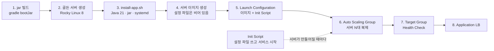

# VM 배포 가이드 (인프라 담당 인수인계)

백엔드를 **NCP 서버(VM)에서 수업 방식으로** 돌리는 방법입니다. Docker를 쓰지 않습니다.
수업 Day2·Day4·실습 9~11과 같은 흐름입니다: **서버 한 대를 완성 → 서버 이미지 → Launch Configuration(+Init Script) → Auto Scaling Group → Load Balancer**.

> **이 문서의 절차는 Rocky Linux 8.9(실습 서버와 같은 계열) + systemd 환경에서 실제로 실행해 검증**했습니다(9장). 단 **NCP 실제 서버·LB·Auto Scaling에서 실행한 것은 아닙니다.** 콘솔 조작은 실습 가이드의 해당 쪽을 따르세요. 이 문서가 보장하는 것은 "서버 안에서 앱이 올라오고 죽고 살아나는 부분"입니다.
>
> 담당 구분(기획서): 서버·LB·Auto Scaling·모니터링 = 정하람, 백엔드·DB = 이상민. 아래 **"누가"** 열을 보세요.

## 0. 한눈에 보기



핵심 설계: **서버 이미지에는 비밀값이 없다.** `/etc/quizrun/quizrun.env`가 비어 있고, 서비스는 이 파일이 비어 있으면 시작하지 않는다(`ConditionFileNotEmpty`). 서버가 만들어질 때 **Init Script가 설정을 쓰고 서비스를 시작**한다.

## 1. 먼저 필요한 것 (서버를 만들기 전에)

| 항목 | 값(제안, 실습과 맞춤) | 근거 | 누가 |
|---|---|---|---|
| VPC | `lab-vpc 10.0.0.0/16` | Day1 | 인프라 |
| App 서브넷 | `web-sub 10.0.1.0/24` (실습은 Public. 운영은 **Private + NAT Gateway** 권장) | 실습 3, Day1 | 인프라 |
| LB 서브넷 | `web-lb-sub 10.0.2.0/24` Public, 용도 LoadBalancer | 실습 9 | 인프라 |
| DB 서브넷 | `db-sub 10.0.3.0/24` **Private**, 용도 일반 | 실습 11 | 인프라 |
| **NAT Gateway** | App 서버가 Private이면 필수: 앱이 CLOVA Studio, 위키백과, 나무위키를 호출하고, `dnf`로 Java를 설치할 때도 필요 | Day1 | 인프라 |
| **Cloud DB for MySQL** | 엔진 8.0.x, **운영은 고가용성(Master+Standby) 체크**, `db-sub`에 생성 | 실습 11 | 인프라 + 백엔드 |
| **Cloud DB for Cache(Redis)** | **방 상태를 담는다. 이게 없으면 서버를 2대 이상 쓸 수 없다.** `db-sub`에 생성 | Day4 무상태 설계 | 인프라 |
| 인증키 | `labkey` (서버 접속용 .pem) | 실습 | 인프라 |

> Cloud DB for Cache는 수업 슬라이드에서 이름만 소개되었고 **실습 가이드에는 생성 절차가 없습니다.** 콘솔 안내를 따라 만들고, 접속 주소·포트·비밀번호·SSL 여부를 백엔드 담당에게 알려 주세요(5장 `REDIS_*`).

### 1.1 ACG (Day1 최소 권한, 실습 11)

| ACG | 방향 | 프로토콜/포트 | 접근 소스 | 설명 |
|---|---|---|---|---|
| `app-acg` (앱 서버) | Inbound | TCP **3000** | LB 서브넷 `10.0.2.0/24` | LB → 앱. 인터넷에서 3000으로 직접 들어오지 못하게 |
| `app-acg` | Inbound | TCP 22 | 관리자 IP만 | SSH(관리용) |
| `app-acg` | Outbound | TCP **443** | 0.0.0.0/0 (NAT 경유) | CLOVA Studio, 위키백과, 나무위키 |
| `app-acg` | Outbound | TCP 3306 | DB ACG | MySQL |
| `app-acg` | Outbound | TCP 6379(Cache 포트) | Cache ACG | Redis |
| **DB ACG** (콘솔이 자동 생성한 `cloud-mysql-…`) | Inbound | TCP **3306** | **접근 소스 = `app-acg`** | 실습 11-3 방식. IP가 아니라 ACG를 소스로 하면 서버가 늘어도 규칙을 바꿀 필요가 없다 |
| **Cache ACG** | Inbound | TCP 6379(Cache 포트) | **접근 소스 = `app-acg`** | 같은 이유 |

> 위 ACG 값은 **제안**입니다. 특히 "LB가 서버에 접속할 때 출발 주소가 LB 서브넷인가"는 콘솔에서 확인하세요(실습 9에서 LB를 만든 뒤 서버 ACG에 어떤 소스를 열어야 접속되는지). 실습 가이드는 서버 ACG에 포트 80을 열어 두는 방식이었습니다.

## 2. jar 만들기

```bash
# Java 21이 있으면
gradle bootJar
# 없으면 (Docker로 빌드만 하고 jar를 꺼낸다 — 배포는 Docker가 아니라 jar 파일)
docker run --rm -v "$PWD":/app -w /app gradle:8.10-jdk21 gradle bootJar -x test --no-daemon
```

결과: `build/libs/quizrun-back-0.3.0.jar` (약 62MB, 실행에 필요한 것이 모두 들어 있는 jar 하나).

## 3. 골든 서버 만들고 앱 설치 (한 번만)

| 단계 | 내용 | 누가 |
|---|---|---|
| 3-1 | 서버 1대 생성: **Rocky Linux 8**, 3세대(KVM) — 실습 서버와 같게. 앱 서브넷, `app-acg`, 인증키 `labkey` | 인프라 |
| 3-2 | jar와 `deploy/vm/` 폴더를 서버로 복사: `scp -i labkey.pem build/libs/quizrun-back-0.3.0.jar <계정>@<서버IP>:~/` 등(실습처럼 MobaXterm 사용 가능) | 인프라/백엔드 |
| 3-3 | 서버에 접속해 설치: `sudo bash deploy/vm/install-app.sh ~/quizrun-back-0.3.0.jar` | 인프라/백엔드 |
| 3-4 | 확인(아래 표) | 인프라 |

`install-app.sh`가 하는 일: ① `dnf install java-21-openjdk-headless` ② 서비스 계정 `quizrun`(로그인 불가) 생성 ③ `/opt/quizrun/app.jar` 배치 ④ systemd 유닛 `quizrun.service` 등록(`enable`) ⑤ **빈** `/etc/quizrun/quizrun.env` 생성(권한 640). **서비스는 시작하지 않는다.**

**3-4 확인(검증된 결과)**

```
java -version                       → openjdk 21
systemctl is-enabled quizrun        → enabled
stat -c %s /etc/quizrun/quizrun.env → 0           (비어 있어야 한다 = 이미지에 비밀값 없음)
systemctl start quizrun             → 시작되지 않음(ConditionFileNotEmpty) — 설정이 없으니 정상
```

### 3.5 서버 이미지 만들기

3-4를 확인한 뒤 이 서버로 **서버 이미지**를 만든다(실습 4: `webserver-image`처럼, 이름 예: `quizrun-image`). 설정 파일이 비어 있으므로 비밀값이 이미지에 남지 않는다.
이 서버는 이미지 원본이므로, 실제 서비스에는 이미지로 새로 만든 서버들을 쓴다.

> Day2 주의: **하이퍼바이저·세대가 다른 서버끼리는 이미지를 옮길 수 없다.** 골든 서버를 3세대(KVM)로 만들었다면 ASG도 3세대로.

## 4. 헬스체크 (Target Group)

| 설정 | 값 | 이유 |
|---|---|---|
| 프로토콜 | HTTP | |
| 포트 | **3000** | 실습은 80이었지만 앱 포트가 3000 |
| **URL Path** | **`/actuator/health/readiness`** | Redis에 연결되지 못한 서버는 **503**을 돌려줘 LB가 제외한다. `/api/health`는 프로세스가 살아 있기만 하면 200이라 **Redis가 죽어도 감지하지 못한다**(검증함) |
| Method | **HEAD** 또는 GET | 둘 다 200/503을 정확히 돌려준다(검증함). 실습은 HEAD |
| 주기 | **5~10초 권장** (허용 5~300초) | 아래 주의 |
| 정상/실패 임계값 | 실습: 2 / 2 | |

> ⚠️ **실습의 헬스체크 값(주기 30초 × 실패 임계값 2)이면 서버가 죽어도 최대 약 60초간 분산 대상에 남는다.** 그 사이 요청의 일부가 죽은 서버로 가서 실패한다. 프론트가 700ms마다 다시 조회하므로 자동으로 회복되지만, 운영에서는 **주기를 5~10초**로 줄이길 권장한다. (로컬 검증에서 죽은 서버 쪽으로 간 요청은 첫 시도가 연결 대기 시간만큼 지연된 뒤 다른 서버로 넘어갔다.)

> 분산 알고리즘: **Round Robin(기본)** 으로 충분하다. **Source IP Hash로 고정할 필요가 없다** — 방 상태는 서버가 아니라 Redis에 있어서 어느 서버로 가도 같은 결과다(검증함). 요청 분산을 검증한 결과: 6문제 한 판이 두 서버에 번갈아 가며 오류 없이 끝났다.

## 5. 설정값과 Init Script

### 5.1 환경변수 (Init Script가 `/etc/quizrun/quizrun.env`에 쓴다)

| 변수 | 필수 | 예 | 설명 | 비밀 |
|---|---|---|---|---|
| `SPRING_PROFILES_ACTIVE` | 고정 | `redis` | **Redis 저장소 + 서버 여러 대 모드.** Init Script가 자동으로 쓴다 | — |
| `PORT` | 고정 | `3000` | 앱 포트 | — |
| `REDIS_HOST` | ✅ | `redis.xxxx` (Cache 접속 주소) | Cloud DB for Cache | — |
| `REDIS_PORT` | 고정 | `6379` | 콘솔의 포트가 다르면 `init-script.sh`를 고친다 | — |
| `REDIS_PASSWORD` | 선택 | | Cache에 비밀번호가 있으면 | ✅ |
| `DB_HOST` | ✅ | `db-xxxx` (**Private 도메인**) | Cloud DB for MySQL 주소(실습 11-4). `DB_URL`을 직접 쓰지 말고 호스트만 | — |
| `DB_USER` | ✅ | `quizrun` | 앱 계정(SELECT/INSERT/UPDATE/DELETE만 권장) | — |
| `DB_PASSWORD` | ✅ | | | ✅ |
| `NCP_CLOVA_API_KEY` | 선택 | `nv-…` | 없으면 AI 문제 생성만 꺼지고 카테고리 문제는 동작 | ✅ |
| `ADMIN_TOKEN` | 선택 | 길고 임의의 값 | 없으면 관리자 API(문제 제외·복구)가 꺼진다 | ✅ |

### 5.2 Init Script 만들기

[`deploy/vm/init-script.sh`](../deploy/vm/init-script.sh)가 틀입니다. `__REDIS_HOST__` 같은 자리표시자를 채워서 콘솔 **Server > Init Script**에 붙여 넣습니다. 손으로 고치지 말고 렌더러를 쓰면 누락·오타를 막아 줍니다.

```bash
# prod.env (Git에 올리지 말 것) — KEY=VALUE, 비워 둘 값은 KEY= 로 적는다
REDIS_HOST=<Cache 접속 주소>
REDIS_PASSWORD=
DB_HOST=<Cloud DB Private 도메인>
DB_USER=quizrun
DB_PASSWORD=<비밀번호>
NCP_CLOVA_API_KEY=<키>
ADMIN_TOKEN=<임의의 긴 값>

python3 deploy/vm/render-init-script.py prod.env > init-script.filled.sh
# init-script.filled.sh 의 내용을 NCP 콘솔 Init Script에 붙여 넣는다. 끝나면 로컬 파일을 지운다.
```

렌더러는 필수 값이 비었거나 키가 없으면 실패하고, 결과에 한글이 있으면 거부합니다.

**NCP Init Script 규칙(수업 Day2) — 어기면 서버 생성 때 조용히 실패한다**

| 규칙 | 이 스크립트 |
|---|---|
| 내용은 **영어만**(한글 불가) | ✅ ASCII만 |
| **주석도 넣지 않는 것**이 공식 규칙 | ✅ 주석 0줄 (설명은 이 문서에) |
| Linux는 **첫 줄 shebang 필수** | ✅ `#!/bin/bash` |
| 이름 3~100자, 영문·숫자·`-`·`_` | 예: `quizrun-init` |

이 규칙은 자동 테스트(`InitScriptTest`)로 고정되어 있어 누가 한글이나 주석을 넣으면 빌드가 실패합니다.

### 5.3 비밀값에 대한 주의

- Init Script의 본문과 실행 로그가 콘솔에 남을 수 있습니다. **DB 비밀번호·CLOVA 키가 이 스크립트에 들어가므로** 콘솔 접근 권한을 최소로 하고, 채워진 스크립트 파일을 채팅·Git에 올리지 마세요.
- 비밀값이 노출됐다고 판단되면 DB 비밀번호·CLOVA 키·`ADMIN_TOKEN`을 바꾸고 Init Script를 새로 만들어 새 Launch Configuration으로 교체합니다.
- 서버 이미지에는 비밀값이 없습니다(3-4에서 확인).

## 6. Launch Configuration · Auto Scaling Group

실습 10과 같은 순서입니다. 값은 **제안**이며 부하 테스트 후 조정해야 합니다.

| 항목 | 제안 | 근거 |
|---|---|---|
| Launch Configuration | 서버 이미지 `quizrun-image`(내 서버 이미지 탭) + **Init Script** + 인증키 `labkey` | 실습 10-1, Day4 |
| 서버 스펙 | 메모리 **4GB 이상**(Standard 계열 2 vCPU 이상) | 측정: 유휴 JVM 약 433MiB, 힙 상한은 메모리의 75%. 100명 폴링 간이 측정에서 여유 있음(용량 근거는 아님) |
| 최소 / 기대 / 최대 | **2 / 2 / 5** (실습은 1 / 2 / 5) | 최소 2로 두면 서버 1대 장애에도 서비스 유지(Day4 SPOF). Multi-Zone이면 서버를 서로 다른 Zone에 |
| 쿨다운 | 60초(실습 기본) | 새 서버가 준비되는 데 약 20초(아래) |
| 정책 | CPU 기반 증가 1대 / 감소 1대 (실습 10-3 Cloud Insight Event Rule). **임계값은 부하 테스트로 정한다** — 실습의 "10% 초과"는 시연용 값 | Day4, 실습 10 |
| ACG | `app-acg` | 실습 10-2 |

**새 서버가 트래픽을 받기까지**: Init Script 실행 후 앱 준비까지 **약 16초**(검증). 서버 생성 + 부팅 시간은 별도입니다. Day2: *"운영중 ≠ 스크립트 실행이 끝났다는 뜻"* — LB 헬스체크가 통과해야 준비된 것입니다.

## 7. DB 스키마 처음 적용

> **현재 앱은 `ddl-auto=update`로 테이블을 자동 생성합니다.** 서버 2대가 **처음에 동시에** 켜지면 같은 테이블을 만들려다 충돌할 수 있습니다(이 충돌은 직접 재현하지 않았고 위험으로만 파악했습니다).

| 순서 | 내용 |
|---|---|
| 1 | ASG **최소/기대 용량을 1**로 시작 → 서버 1대가 `readiness 200`이 될 때까지 기다린다(이때 테이블 자동 생성, 문제은행 180개 적재) |
| 2 | 그 뒤 기대 용량을 2로 올린다 |
| (권장, 다음 단계) | 스키마를 SQL로 먼저 적용하고 `ddl-auto`를 `validate`로. 목표 스키마는 [DB 설계서](database-design.md)와 `db/schema.sql` (**코드가 아직 v1이라 전환 후에 적용**) |

로컬 `docker-compose.scale.yml`도 같은 이유로 `app2`를 `app1`이 healthy가 된 뒤에 켭니다.

## 8. 운영

### 8.1 새 버전 배포

1. 새 jar 빌드 → 골든 서버에서 `install-app.sh`로 교체(또는 새 골든 서버) → **새 서버 이미지**
2. **새 Launch Configuration**(새 이미지 + 같은 Init Script) → ASG에 연결
3. 서버를 한 대씩 교체(새 서버가 readiness 200이 된 뒤 옛 서버 제거)

신구 버전이 잠깐 섞여도 괜찮도록 방 저장 형식은 **모르는 필드를 무시**하게 만들었습니다(`RoomCodecTest`). 방 상태는 Redis에 있으므로 서버를 교체해도 진행 중인 방은 유지됩니다.
**다만 방의 필수 필드를 바꾸는 배포는 한꺼번에 하지 마세요**(미검증).

### 8.2 점검 명령

| 확인 | 명령 |
|---|---|
| 서비스 상태 | `systemctl status quizrun` |
| 로그 | `journalctl -u quizrun -f` (stdout이 곧 로그) |
| 준비 상태 | `curl -i localhost:3000/actuator/health/readiness` (200 = 준비됨, 503 = Redis/DB 문제) |
| 설정 확인(값 노출 주의) | `sudo cat /etc/quizrun/quizrun.env` |
| 재시작 | `sudo systemctl restart quizrun` |

### 8.3 증상별

| 증상 | 가능한 원인 | 확인 |
|---|---|---|
| 서비스가 안 올라온다 (`inactive`, 조건 불충족) | Init Script가 실행되지 않았거나 실패 | `stat -c %s /etc/quizrun/quizrun.env`가 0이면 Init Script 미실행. 콘솔의 실행 로그 확인, 규칙 위반(한글·주석·shebang) 점검 |
| readiness가 503 | Redis 또는 DB에 연결되지 않음 | ACG(앱 → Cache/DB), 접속 주소·비밀번호, Cache/DB가 같은 VPC인지. Redis가 복구되면 **약 5~10초 안에 스스로 회복**(검증함) |
| 방을 만들면 "서버에 문제가 생겼어요"(500) | Redis 장애 중 | 위와 같음. 서버는 Redis가 돌아오면 재시작 없이 정상화 |
| `Access denied` (DB) | 계정·호스트 | 실습의 `HOST %`는 시연용. 운영은 앱 서브넷 대역으로 제한 |
| 한글이 `?`로 저장 | JDBC URL 문자 인코딩 | `DB_URL`에 `characterEncoding=UTF-8`(Init Script가 이미 포함) |
| AI 문제가 안 만들어진다 | 외부(443) 호출 불가 | NAT Gateway, Outbound ACG. `NCP_CLOVA_API_KEY` |
| LB가 서버를 제외하지 않는다 | Health Check 경로가 `/api/health` | `/actuator/health/readiness`로 변경 |

## 9. 검증 기록

환경: Docker 위의 **Rocky Linux 8.9 + systemd(PID 1)**. 앱은 Docker가 아니라 `install-app.sh` → Init Script → systemd로만 올렸고, 같은 네트워크의 Redis·MySQL과 Docker로 띄운 서버 2대(LB 포함)가 함께 있었다.

| 검증 | 결과 |
|---|---|
| `dnf install java-21-openjdk-headless` | 기본 저장소(AppStream)에서 설치됨 (21.0.12) |
| `install-app.sh` 후 서버 이미지 시점 | 서비스 `enabled`, 설정 파일 **0바이트**, 권한 640 `root:quizrun`, jar 640 `quizrun:quizrun` |
| 설정이 비어 있을 때 `systemctl start` | **시작되지 않음**(`ConditionFileNotEmpty`) — 이미지에 비밀값이 없고 설정 없이 뜨는 서버도 없다 |
| `systemd-analyze verify` | 오류 없음 |
| Init Script 렌더 + 실행(root) | 종료코드 0, **약 16초 만에 readiness 200**, 프로세스 소유자 `quizrun`(root 아님) |
| 렌더러 입력 검증 | 필수 키가 없으면 실패, 결과 ASCII·주석 없음 |
| **상태 공유** | VM에서 만든 방을 Docker 서버가 조회·입장 가능(200), VM이 입장 결과 반영 |
| **kill -9** | systemd가 **약 19초 만에 되살림**(`Restart=on-failure`), 그 사이 다른 서버가 같은 방을 계속 서비스, 되살아난 뒤에도 방 유지 |
| `systemctl stop` | `inactive`(실패 아님) — Spring의 종료코드 143을 정상으로 처리(`SuccessExitStatus=143`) |
| Redis 정지 | VM/서버 readiness 503, `/api/health`는 200 유지, Redis 복구 후 5~10초 내 200 |

**이 검증이 보장하지 않는 것**
- NCP 서버·서버 이미지·Launch Configuration·Auto Scaling·Application LB에서의 실행(콘솔 조작, 이미지 생성 시간, Init Script 실행 시점 등).
- Cloud DB for Cache(Redis)에 대한 접속(인증·SSL 방식). 코드는 `REDIS_PASSWORD`, `REDIS_SSL`을 지원하지만 실제 인스턴스로 시험하지 않았다.
- 부하 상황의 확장 정책 임계값.

## 10. 인프라 담당과 맞출 체크리스트

- [ ] Cache 접속 주소·포트·비밀번호·SSL 여부를 백엔드 담당에게 전달
- [ ] DB Private 도메인, `quizrun` 계정, 스키마 적용 방식(최초 1대)
- [ ] Target Group Health Check: HTTP / 포트 3000 / `/actuator/health/readiness` / HEAD / 주기 5~10초
- [ ] `app-acg`, DB ACG(소스 = `app-acg`), Cache ACG(소스 = `app-acg`)
- [ ] NAT Gateway(앱 Outbound 443, `dnf` 설치)
- [ ] ASG 최소 2 / 기대 2 / 최대 5, Multi-Zone
- [ ] Init Script 이름과 보관 방법(채워진 파일은 Git 금지)
- [ ] 서버 이미지 세대(KVM 3세대)와 ASG 서버 세대 일치
